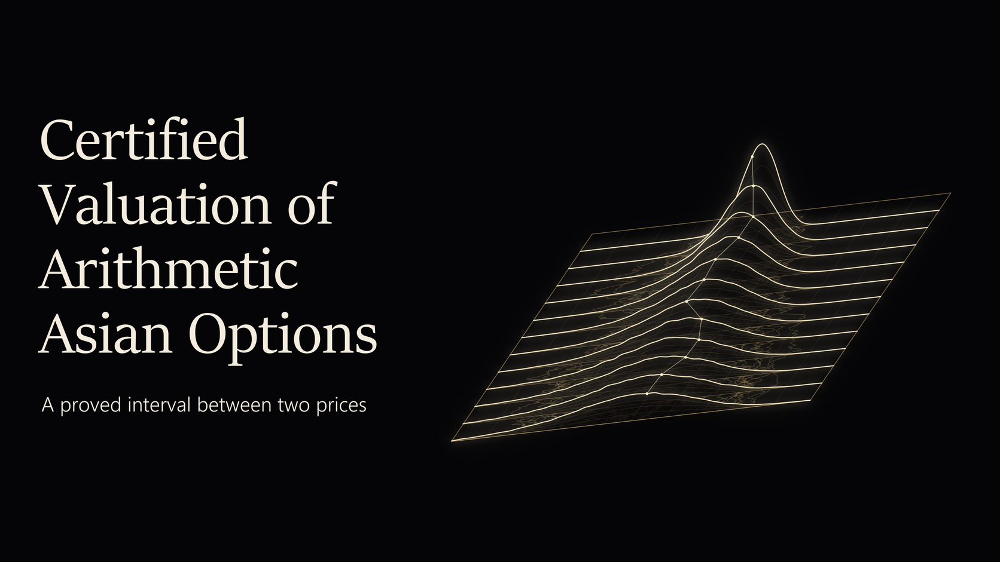
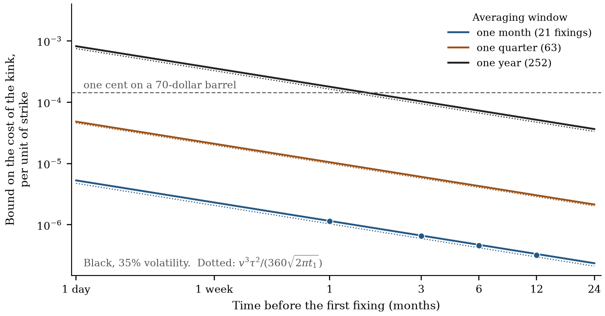
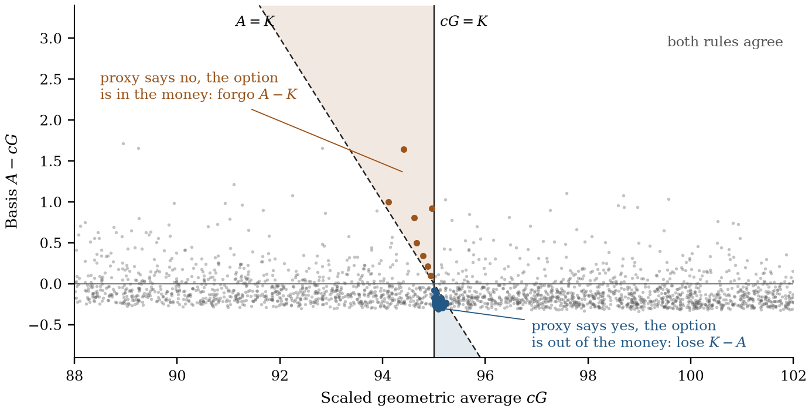

# Certified Valuation of Arithmetic Asian Options

**What does it cost to exercise an average-price option on the geometric average, and how far is a simulated price from the model that was calibrated?**

[Read the paper](manuscript/report.md) · [PDF](paper/paper.pdf) · [Mathematical structure](docs/MATHEMATICAL-STRUCTURE.md) · [Computation](docs/COMPUTATION.md) · [Evidence](docs/EVIDENCE.md)



Oil, metals and currency hedges pay on an arithmetic average, which has no closed-form law; the geometric average does. Exercising the option on a scaled geometric average costs the expected overshoot when the two averages fall on opposite sides of the strike. I prove that this cost is at most a dispersion divided by a level risk, show that for a calendar-month crude oil option it is below a hundredth of a cent per barrel, and turn it into a proved price interval under Heston where it is not small.

Research by **Theodore Ouyang** · 2026

## Three results to start with

| Result | Why it matters | Evidence |
|---|---|---|
| **A hundredth of a cent per barrel** | For a one-month crude oil average price option, one to twelve months ahead, the closed-form value of exercising on the geometric average is proved to be within 0.0023 to 0.0081 cents of the Black price. The true cost is 65 to 94 percent of that bound. The classical first-order bound for the same contracts is 2.6 cents. | Theorem 3.3 and Proposition 4.1; [contracts that trade](manuscript/report.md#42-contracts-that-trade) |
| **A price interval 16 basis points wide** | For a twelve-fixing 95–110 call spread under Heston, the continuous price lies in $`[6.508371733,\;6.518868974]`$ and the price under a 768-step Euler scheme within 0.011025 of it. Projection, inversion tails, periodization and rounding are inside the interval. | Theorem 5.1 and Corollary 5.2; [the certificate](manuscript/report.md#54-the-certificate) |
| **Euler bias of $`-0.156\,h`$** | One Euler step of the model is one explicit Euler step of its Riccati equation. The finite sums inside the certificate show the bias halving with the step: $`-0.000407`$, $`-0.000203`$, $`-0.000101`$. The proved bound is 54 times the observed gap, and the paper names the cancellation that accounts for the difference. | Proposition 6.1; [the bias of the proxy value](manuscript/report.md#62-the-bias-of-the-proxy-value-is-first-order) |

The oil option has 21 daily fixings of a 70-dollar futures price at 35 percent volatility. The Heston contract has $`S_0=100`$, $`r=.01`$, twelve monthly fixings and $`(\kappa,\bar v,\xi,\rho,v_0)=(3,.045,.23,-.55,.045)`$.

## The result behind the headline



With $`A`$ the arithmetic and $`G`$ the geometric average of the fixings, and $`\sigma`$ the volatility of the Gaussian part of the return before the first fixing,

```math
0\le E(A-K)^+-E\bigl[(A-K)\mathbf 1_{\{cG\gt K\}}\bigr]
\le\frac{K}{\sqrt{2\pi}}\,E\!\left[\frac{d(A/cG)}{\sigma}\right],
\qquad d(x)=x-1-\log x .
```

In Black's model with volatility $`v`$, a window $`\tau`$ and a lead time $`t_1`$, the right side is $`v^3\tau^2/(360\sqrt{2\pi t_1})`$ per unit of strike to leading order. The bound grows with the cube of volatility and the square of the window and falls with the square root of the lead time. A calendar-month window sits two orders of magnitude below one cent on a 70-dollar barrel; an annual window sits at a cent, which on a sovereign-scale hedge of 330 million barrels is three million dollars.

## The mathematical idea



The holder who must exercise on a proxy loses only when the strike separates the proxy from the true average, and then loses the distance from the average to the strike. That event has probability of the order of the basis, so the cost is of second order.

Across strikes the cost obeys a conservation law. Integrated with the weights that replicate a log contract it equals the Bregman divergence $`E\,d(A/cG)`$, a number that depends only on the shape of the path.

The return before the first fixing moves every fixing by the same factor. Given everything else, that factor is lognormal, so the cost at one strike is at most the total mass times the peak of a Gaussian density of width $`\sigma`$. Dispersion inside the window over level risk before it: that ratio is the whole bound.

## What the paper adds

Conditioning on the geometric average goes back to Curran and to Rogers and Shi, and Fusai and Kyriakou carry it to stochastic volatility by transforms. Their error bounds are of first order in the conditional standard deviation. The bound here is of second order, holds for any model with a common Gaussian factor, and is nearly attained on the contracts that trade. The paper adds:

- the identification of the proxy error with the Bregman divergence of the call payoff, and its exact integrals across strikes;
- the kink bound, its matching lower bound, and the best scale, the weighted mean of $`A/G`$;
- the cubic law and proved price intervals in ball arithmetic for market-style contracts;
- a complete certificate under Heston for a specified Euler kernel: projection, validated quadrature, inversion tails and rounding in one budget;
- the reading of Euler's bias as an Euler error on the Riccati equation, and on the deterministic face as a vega times a quadrature error;
- a transfer of the fixed-parameter bounds to every posterior quantile after calibration.

- [Mathematical structure](docs/MATHEMATICAL-STRUCTURE.md): the argument in seven steps and its limits.
- [Computational details](docs/COMPUTATION.md): how the proofs connect to finite calculations.
- [Code and evidence](docs/EVIDENCE.md): each result with its program and its exact output.

## Paper

**Certified Valuation of Arithmetic Asian Options: The Cost of Exercising on the Geometric Average** — Theodore Ouyang, 2026.

[Article](manuscript/report.md) · [PDF](paper/paper.pdf)

[theodore.oy2025@gmail.com](mailto:theodore.oy2025@gmail.com) · [10@alumni.duke.edu](mailto:10@alumni.duke.edu)

© Theodore Ouyang. All rights reserved.
