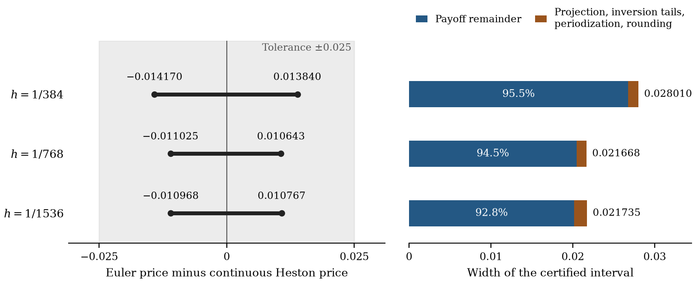

# Certified Valuation of Arithmetic Asian Options

**How far is an Euler-scheme Asian price from the price of the Heston model that was calibrated?**

[Read the paper](manuscript/report.md) · [PDF](paper/paper.pdf) · [Mathematical structure](docs/MATHEMATICAL-STRUCTURE.md) · [Computation](docs/COMPUTATION.md) · [Evidence](docs/EVIDENCE.md)


An arithmetic Asian price computed under a projected Euler scheme need not equal the price of the Heston model that was calibrated. For a specified Heston model I bound the difference: a finite, signed interval for the price gap between the continuous model and positive-part variance Euler with a current-variance log-price update.

Research by **Theodore Ouyang** · 2026

## Three results to start with

| Result | Why it matters | Evidence |
|---|---|---|
| **Within 0.011025 of the Heston price** | For a one-year, twelve-fixing 95–110 Asian call spread, the projected-Euler price is certified to differ from the continuous Heston price by less than 0.011025, inside the 0.025 tolerance. The interval is signed, and every numerical error is inside it. | Theorem 4.1 and Corollary 4.2; [the certificate](manuscript/report.md#4-the-main-theorem-and-the-complete-price-certificate) |
| **94.5% of the width from one term** | The payoff remainder accounts for about 0.0205 of the 0.0217 interval width. Projection, inversion tails, periodization and rounding share the rest, so the certificate shows where a sharper bound has to come from. | Table 8; [width contributions](manuscript/report.md#82-step-grid-certificates-and-the-width-plateau) |
| **99.4% narrower under coupling** | A direct coupling argument keeps the cancellation between the two nonlinear remainders. In a deterministic-variance example it cuts the nonlinear remainder width from approximately 0.01538363715 to 0.00008815020. | Appendix H; [coupled remainder](manuscript/report.md#h1-an-executed-coupling-example-on-the-deterministic-variance-face) |

The certificate uses $`h=1/768`$, $`S_0=100`$, $`r=.01`$ and $`(\kappa,\bar v,\xi,\rho,v_0)=(3,.045,.23,-.55,.045)`$. The coupling example has $`\xi=0`$, $`v_0=.04`$, the same fixing dates and the same step.

## The result behind the headline



With $`p_h`$ the projected-Euler price and $`p_c`$ the continuous Heston price, the complete certificate at $`h=1/768`$ is

```math
p_h-p_c\in[-0.011024692273,\;0.010642371599],
\qquad |p_h-p_c|\lt0.011025,
```

and the continuous price is enclosed by $`[6.508371733,6.518868974]`$. All three certified steps meet the **0.025** tolerance. Halving the step from $`1/384`$ to $`1/768`$ narrows the interval. Halving it again does not, because the discrete frequency-tail contribution grows by more than the payoff remainder and the projection contribution shrink. The plateau describes the enclosure, not the true price error. The figure's labels are rounded outward.

## The mathematical idea

The method starts from an **exact conditional price**. Every fixing carries the stock noise accumulated before the first observation, so one Gaussian integral can be evaluated explicitly. The geometric average keeps that common factor, and its logarithm is linear in the observed log prices, which makes it a reference that Heston transforms can handle. Convexity and conditional curvature then bound what is left of the arithmetic payoff by a weighted second moment.

The payoff decomposition fixes the transform catalog: for the twelve-fixing contract, 13 complex loadings for the linear term and 91 real loadings for the squared remainder. The validated evaluation puts variance projection, inversion, integration tails, complex-logarithm branches and rounding into one error budget in price units.

## What the paper adds

The work builds on established conditioning and geometric-reference methods for Asian options, Fusai–Kyriakou among them. What it adds is the weighted control of the payoff kink and a complete error construction for the specified projected kernel:

- an exact linear-reference decomposition whose nonnegative remainder is controlled by a weighted second moment;
- a projection correction between the algebraic transform recursion and the positive-part variance Euler law that is actually simulated;
- finite loading catalogs with certified quadrature, infinite-tail bounds and complex-logarithm branch checks;
- rational endpoint combination and ball arithmetic, which put rounding in the same budget as every other error.

The weak expansions and the posterior-quantile transfer are separate applications on explicitly restricted model families.

- [Mathematical structure](docs/MATHEMATICAL-STRUCTURE.md): the six steps of the construction, from the exact conditional price to the information the bound gives up.
- [Computational details](docs/COMPUTATION.md): how the proof connects to its finite moment calculations, parameter inputs and exact error ledgers.
- [Code and evidence](docs/EVIDENCE.md): each result with its program and its exact output.

## Paper

**Certified Valuation of Arithmetic Asian Options** — Theodore Ouyang, 2026.

[Article](manuscript/report.md) · [PDF](paper/paper.pdf)

[theodore.oy2025@gmail.com](mailto:theodore.oy2025@gmail.com) · [10@alumni.duke.edu](mailto:10@alumni.duke.edu)

© Theodore Ouyang. All rights reserved.
