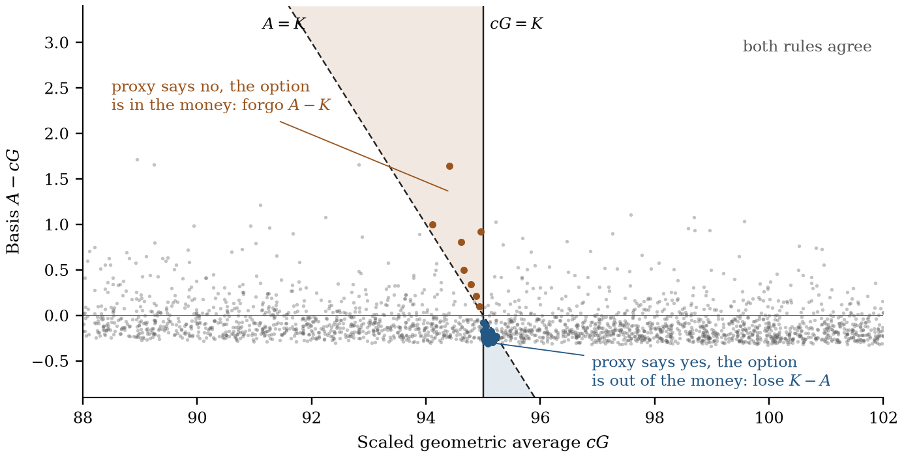
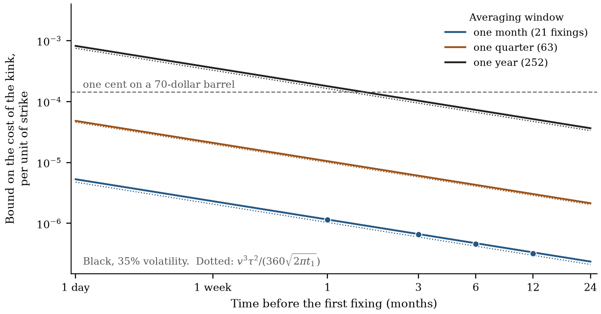
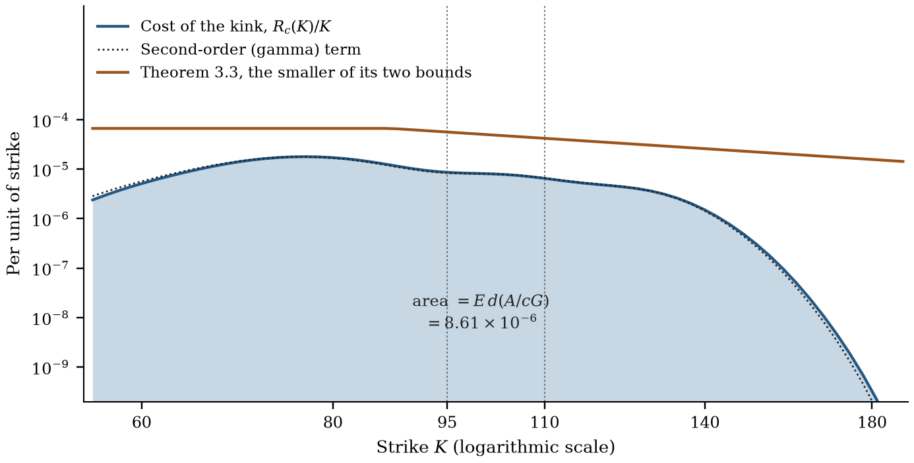
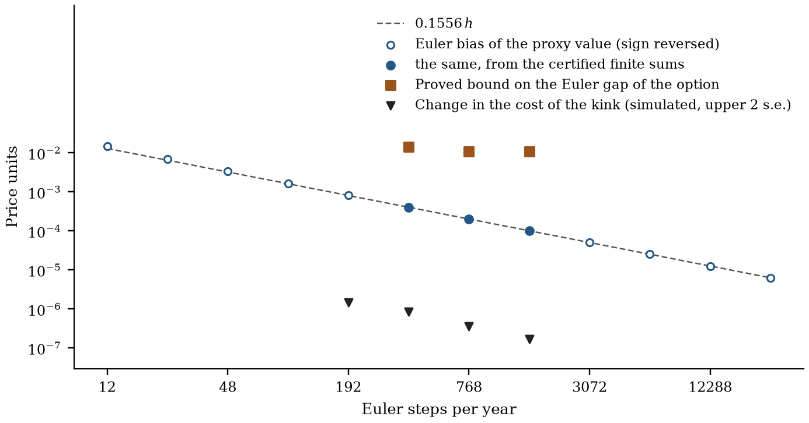

# Certified Valuation of Arithmetic Asian Options

[English PDF](../paper/paper.pdf) · [Repository](../README.md) · [Code and evidence](../docs/EVIDENCE.md)

The Cost of Exercising on the Geometric Average

**Theodore Ouyang**

[theodore.oy2025@gmail.com](mailto:theodore.oy2025@gmail.com) · [10@alumni.duke.edu](mailto:10@alumni.duke.edu)

2026

**Keywords:** Asian options; average price options; geometric conditioning; Bregman divergence; stochastic volatility; Heston model; Euler discretization; validated numerics; model risk.

**JEL classification:** G13; C63; C65.

**MSC 2020:** 91G20; 91G60; 60H35; 65G30.

## Abstract

An arithmetic Asian option is worth more than the same payoff when exercise is decided by a scaled geometric average of the fixings. We call the difference the cost of the kink and prove three things about it. It is the expected overshoot on the event that the two averages fall on opposite sides of the strike. Integrated across strikes with the weights that replicate a log contract, it equals a Bregman divergence between the two averages. Whenever the return before the first fixing has a conditionally Gaussian component with volatility $`\sigma`$, it is at most

```math
\frac{K}{\sqrt{2\pi}}\,E\!\left[\frac{d(A/cG)}{\sigma}\right],\qquad d(x)=x-1-\log x.
```

In Black's model this bound is $`v^3\tau^2/(360\sqrt{2\pi t_1})`$ per unit of strike to leading order, for volatility $`v`$, an averaging window $`\tau`$ and a lead time $`t_1`$. For a one-month crude oil average price option it is below one hundredth of a cent per barrel and within a factor of 1.1 to 1.5 of the true cost; for an annual-average put on the scale of a sovereign oil hedge it is under one cent per barrel. For a twelve-fixing 95–110 call spread under Heston, validated transforms turn the bound into a proved price interval, $`[6.508371733,\;6.518868974]`$, and a proved bound of 0.011025 on the distance to the price under a 768-step Euler scheme. The same computation shows that the Euler bias of the proxy value is first order in the step $`h`$, with leading coefficient $`-0.156`$.

## 1. Introduction

Most options written on oil, metals, freight and corporate currency flows pay on an average. A refiner buys crude every day of the month and an airline burns fuel every day of the quarter, so their physical contracts are priced on monthly averages and their hedges follow. The NYMEX average price option on crude oil settles on the mean of the daily futures settlements in a calendar month [[10](#ref-10)]. The London Metal Exchange lists options on the monthly average of its official settlement prices, the price at which physical metal changes hands [[25](#ref-25)]. Mexico's treasury insures its oil revenue with puts on the average price over a year [[35](#ref-35)]; the programme for 2009 covered 330 million barrels at 70 dollars and paid out 5.085 billion dollars [[4](#ref-4)].

The payoff of such a contract depends on the arithmetic average $`A`$ of the fixings, whose law has no closed form in any standard model. The geometric average $`G`$ does, and practice rests on that fact. Kemna and Vorst use the geometric option as a control variate [[21](#ref-21)]. Curran, and Rogers and Shi, condition on $`G`$ and obtain a lower bound that is accurate to several digits in Black's model [[12](#ref-12), [31](#ref-31)]. Fusai and Kyriakou carry the same bound to stochastic volatility and jumps by transform methods [[16](#ref-16)]. Under stochastic volatility the working alternative is simulation on a time grid, which adds a discretization bias to the sampling error.

Two numbers in this workflow usually come without a proof. One is the distance between the conditioning lower bound and the price. The other is the distance between the price under the discretized dynamics and the price under the model that was calibrated. The classical estimate of the first is of first order in the conditional standard deviation of $`A`$ given $`G`$, which makes it loose exactly where the lower bound is good. The second is known to be of first order in the step for smooth payoffs [[28](#ref-28)], with an unknown constant. A valuation is certified when both distances are replaced by inequalities whose every term has been computed with a rigorous error. This paper does so, and it starts from a description of the first distance that makes its size predictable.

### 1.1 The idea

Suppose the holder of an arithmetic call must decide exercise by looking at a proxy $`B`$ instead of $`A`$: she receives $`A-K`$ when $`B\gt K`$ and nothing otherwise. She can only lose by this, and she loses on two events. If the proxy is below the strike while $`A`$ is above, she forgoes $`A-K`$. If the proxy is above while $`A`$ is below, she pays $`K-A`$. In both cases the strike lies between the proxy and the truth, so the loss is at most $`|A-B|`$ and it occurs with a probability of order $`|A-B|`$ times the density of the proxy at the strike. The cost is of second order in the basis $`A-B`$. Figure 1 shows the two events for the contract of Section 5.

The second-order statement becomes an inequality when the density at the strike can be bounded, and here a structural fact helps. The return realized before the first fixing moves every fixing by the same factor. If part of that return is Gaussian given everything else, with volatility $`\sigma`$, then conditionally the option is a Black–Scholes call on that factor, and the density at the strike is at most $`1/(\sigma\sqrt{2\pi})`$ in log-strike. With $`B=cG`$ the basis depends only on the shape of the path, since $`A/G`$ is unchanged when all fixings are scaled together. The cost of the kink is therefore controlled by a ratio: the dispersion of the fixings about their own average, divided by the level risk that precedes them.



**Figure 1. Where exercising on the geometric average goes wrong.** Simulated paths of the twelve-fixing Heston contract of Section 5 with $`88\lt cG\lt 102`$, 2,231 of a sample of 6,000, and strike $`K=95`$. A path costs something only if the strike separates $`cG`$ from $`A`$, which happens on 34 of them: the shaded wedges. The cost on such a path is its horizontal distance to the dashed line $`A=K`$, which is at most the size of its basis.

### 1.2 Results

Section 3 proves the general statements. Proposition 3.1 identifies the cost of the kink with the Bregman divergence generated by the call payoff and shows that its integral across strikes is exact: with weights $`dK`$ it equals $`E(A-B)^2/2`$, and with the weights $`dK/K^2`$ that replicate a log contract it equals $`E\,d(A/B)`$, where $`d(x)=x-1-\log x`$. Theorem 3.3 adds the common factor. For every strike,

```math
\begin{gathered}
0\le E(A-K)^+-E\bigl[(A-K)\mathbf 1_{\{B\gt K\}}\bigr]
\le\frac{K}{\sqrt{2\pi}}\,E\!\left[\frac{d(A/B)}{\sigma}\right],
\end{gathered}
\tag{1.1}
```

and the same bound holds with $`E[(A-B)^2/\sigma]/(2K\sqrt{2\pi})`$ on the right. Each bound is a total mass from Proposition 3.1 multiplied by the largest value a Gaussian density of width $`\sigma`$ can take. A matching lower bound shows that (1.1) is attained for at-the-money options whose dispersion is small relative to $`\sigma`$. For $`B=cG`$ the best constant is the mean of $`A/G`$ weighted by $`1/\sigma`$, and the bound at that scale is $`K/\sqrt{2\pi}`$ times $`E[1/\sigma]`$ times the mean log deviation of $`A/G`$ (Proposition 3.4). Because the Curran, Rogers–Shi and optimized Fusai–Kyriakou lower bounds dominate the proxy value, (1.1) also bounds their errors.

Section 4 evaluates the bound where contracts trade. In Black's model with volatility $`v`$, a lead time $`t_1`$ before the first fixing and a window $`\tau`$, the bound per unit of strike is

```math
\begin{gathered}
\frac{v^3\tau^2}{360\sqrt{2\pi t_1}}
\end{gathered}
\tag{1.2}
```

to leading order under continuous monitoring, with an explicit correction for $`n`$ fixings (Proposition 4.1). For a calendar-month crude oil option one to twelve months ahead, ball arithmetic gives price intervals 0.0023 to 0.0081 cents per barrel wide, and simulation puts the true cost at 65 to 94 percent of the bound. The classical first-order bound for the same contracts is 2.6 cents. Under Heston dynamics with a volatility of volatility of 0.7 the cost is about 0.005 to 0.008 cents and the bound 0.006 to 0.013. For an annual-average put on 330 million barrels the bound is 0.91 cents per barrel in Black's model, three million dollars on a premium of 569 million.

Section 5 turns the bound into a certificate for a contract on which it is not small: a 95–110 call spread on twelve monthly fixings under Heston with $`S_0=100`$. The proxy value is computed by validated transform inversion and the weighted second moment by validated quadrature, with projection, tails, periodization and rounding inside the budget. The continuous price lies in

```math
\begin{gathered}
[6.508371733,\;6.518868974],
\end{gathered}
\tag{1.3}
```

the price under absorbed Euler with step $`h=1/768`$ lies in $`[6.507844281,\;6.519014106]`$, and their difference in $`[-0.011024692273,\;0.010642371599]`$.

Section 6 explains the Euler error that these intervals enclose. One Euler step of the stochastic differential equation acts on exponential-affine functions as one explicit Euler step of the Riccati equation (Proposition 6.1). The finite sums already enclosed by the certificate then display a first-order bias in the proxy value: $`-0.000406686`$, $`-0.000202992`$ and $`-0.000101409`$ at 384, 768 and 1536 steps, with leading coefficient $`-0.156`$. Simulation puts the change in the cost of the kink between the two laws below $`10^{-6}`$. The Euler price at 768 steps is therefore about 0.0002 below the continuous price, and the proved bound of 0.011025 is the price of proving it without coupling the two laws. On the deterministic-variance face the leading error is a vega multiplied by the quadrature error of the Euler variance (Theorem 6.2).

Section 7 carries the fixed-parameter bounds through a calibration and bounds the displacement of every posterior quantile of the Asian price. Section 8 describes two uses: an acceptance test for pricing engines and a numerical component of a valuation reserve. Section 9 states the limits.

### 1.3 Related work

Geometric conditioning starts with Curran [[12](#ref-12)] and Rogers and Shi [[31](#ref-31)]. Rogers and Shi bound the error of their lower bound by half the expected conditional standard deviation of the average, an estimate of first order. Thompson [[33](#ref-33)], Nielsen and Sandmann [[29](#ref-29)] and Lord [[26](#ref-26)] sharpen it in the lognormal model; in Thompson's example the Rogers–Shi upper bound is 9.039 against a lower bound of 8.8275 and his own upper bound of 8.8333. Fusai and Kyriakou [[16](#ref-16)] optimize the exercise threshold, treat stochastic volatility and jump models through the joint transform of the price and its geometric average, and state a conditional-variance error bound of the Rogers–Shi type (their Theorem 4), which they evaluate numerically. Moment matching [[34](#ref-34), [24](#ref-24)] and the Laplace transform of Geman and Yor [[17](#ref-17)] are the other classical routes in the lognormal model.

Relative to this literature, Theorem 3.3 is an a priori error bound of second order that holds beyond the lognormal model and needs only moments of the fixings weighted by $`1/\sigma`$. It is silent when averaging starts at once, where Thompson's bound remains the reference in Black's model.

The decomposition of a convex payoff into calls is due to Breeden and Litzenberger [[6](#ref-6)] and Carr and Madan [[9](#ref-9)], and the weights $`dK/K^2`$ are those of the variance swap [[13](#ref-13)]. In forecast evaluation the same pathwise quantity is the elementary score of Ehm, Gneiting, Jordan and Krüger [[14](#ref-14)], who read it as the regret of an investor acting on a point forecast and prove the mixture representation of Bregman scores; Proposition 3.1 is that representation with exercise in the role of investment.

Heston's affine structure supplies the continuous transforms [[19](#ref-19)], and recursive transforms for discrete geometric averages are available [[22](#ref-22), [30](#ref-30)]. The scheme studied here is the absorption fix in the classification of Lord, Koekkoek and van Dijk [[27](#ref-27)]; Broadie and Kaya [[8](#ref-8)] and Andersen [[1](#ref-1)] give exact and moment-matched alternatives. Mickel and Neuenkirch prove weak order one for the absorbed scheme and smooth payoffs when the Feller index exceeds one [[28](#ref-28)]; Talay and Tubaro [[32](#ref-32)] and Bally and Talay [[2](#ref-2)] are the classical references for weak expansions. Error control for transform inversion follows Lee [[23](#ref-23)], and all enclosures use the ball arithmetic of Arb [[20](#ref-20)].

## 2. Average-price contracts and their two averages

### 2.1 The contract

Fix dates $`0\lt t_1\lt \cdots\lt t_n=T`$ and let $`S_{t_1},\ldots,S_{t_n}`$ be the fixings of a positive price. Put

```math
\begin{gathered}
A=\frac1n\sum_{i=1}^nS_{t_i},\qquad
G=\Bigl(\prod_{i=1}^nS_{t_i}\Bigr)^{1/n},\qquad
X=\frac AG .
\end{gathered}
\tag{2.1}
```

An average price call pays $`(A-K)^+`$ at $`T`$ and a put pays $`(K-A)^+`$. We call $`t_1`$ the lead time and $`\tau=t_n-t_1`$ the window. For the exchange-traded contracts of the introduction the window is a calendar month of daily fixings and the lead time is whatever remains until that month begins. For Mexico's hedge the window is a year.

Two elementary reductions are used throughout. Put–call parity holds for the average, $`(A-K)^+-(K-A)^+=A-K`$, so a statement about calls is a statement about puts. And a fixing that has been observed is a constant: if $`m`$ fixings with mean $`\bar a`$ are known, then

```math
\begin{gathered}
(A-K)^+=\frac{n-m}{n}\,\bigl(A'-K'\bigr)^+,\qquad K'=\frac{nK-m\bar a}{n-m},
\end{gathered}
\tag{2.2}
```

where $`A'`$ is the mean of the remaining fixings. An option inside its window is an option on the fixings still to come with a shifted strike, or a forward if $`K'\le0`$. The lead time is therefore always the time to the next unknown fixing.

### 2.2 The gap between the averages is dispersion

Write $`z_i=\log S_{t_i}`$, $`\bar z`$ for their mean, $`u_i=z_i-\bar z`$, and

```math
s^2=\frac1n\sum_{i=1}^nu_i^2,\qquad m=\max_i|u_i| .
```

Then $`G=e^{\bar z}`$ and $`X=n^{-1}\sum_ie^{u_i}`$. Since the $`u_i`$ sum to zero and $`e^u-1-u`$ lies between $`u^2e^{-|u|}/2`$ and $`u^2e^{|u|}/2`$,

```math
\begin{gathered}
\tfrac12s^2e^{-m}\le X-1\le\tfrac12s^2e^{m}.
\end{gathered}
\tag{2.3}
```

The arithmetic average is the geometric average marked up by half the dispersion of the log fixings about their own mean. The markup does not change when every fixing is multiplied by the same number: $`X`$ is a function of the shape of the path only.

In financial terms the position long $`A`$ and short $`G`$ is a claim on the realized variance of the fixing series, with no exposure to the level at first order. In Black's model with volatility $`v`$ and continuous monitoring over a window $`\tau`$, $`s^2`$ has mean $`v^2\tau/6`$ and variance $`v^4\tau^2/45`$ (Section 4), so $`X`$ is about $`1+v^2\tau/12`$ and its randomness is of order $`v^2\tau`$ times $`0.07`$. Under stochastic volatility the dispersion inherits the volatility risk, and with a negative correlation between price and variance it is larger on paths that end low. That asymmetry is visible in the numerical profile of Section 5.

## 3. Exercising on a proxy

### 3.1 The cost of the kink

Let $`A`$ and $`B`$ be positive random variables with finite means; $`B`$ is the proxy. For $`K\gt 0`$ put

```math
\begin{gathered}
C(K)=E(A-K)^+,\qquad
L_B(K)=E\bigl[(A-K)\mathbf 1_{\{B\gt K\}}\bigr],\qquad
R_B(K)=C(K)-L_B(K).
\end{gathered}
\tag{3.1}
```

$`L_B(K)`$ is the value of the call when exercise is decided by $`B`$; we call it the proxy value and $`R_B(K)`$ the cost of the kink. For $`B=cG`$ we write $`L_c`$ and $`R_c`$. Prices are discounted at the end.

**Proposition 3.1 (The cost of the kink).** For all positive numbers $`A,B,K`$,

```math
\begin{gathered}
(A-K)^+-(A-K)\mathbf 1_{\{B\gt K\}}
=(A-K)\mathbf 1_{\{B\le K\lt A\}}+(K-A)\mathbf 1_{\{A\le K\lt B\}}\ \ge0 .
\end{gathered}
\tag{3.2}
```

The put payoff $`(K-A)^+`$ and its proxy version $`(K-A)\mathbf 1_{\{B\le K\}}`$ differ by the same quantity. Consequently $`R_B(K)\ge0`$ is the expected distance from $`A`$ to the strike on the event that the strike separates $`A`$ from $`B`$, for calls and puts alike. If $`\varphi`$ is convex on $`(0,\infty)`$ with a locally absolutely continuous derivative, then

```math
\begin{gathered}
\int_0^\infty R_B(K)\,\varphi''(K)\,dK
=E\bigl[\varphi(A)-\varphi(B)-\varphi'(B)(A-B)\bigr],
\end{gathered}
\tag{3.3}
```

both sides being finite or infinite together. In particular

```math
\begin{gathered}
\int_0^\infty R_B(K)\,dK=\tfrac12E(A-B)^2,\qquad
\int_0^\infty R_B(K)\,\frac{dK}{K^2}=E\,d(A/B),\qquad d(x)=x-1-\log x .
\end{gathered}
\tag{3.4}
```

*Proof.* Identity (3.2) is a check of the four cases given by the positions of $`A`$ and $`B`$ relative to $`K`$; the put follows from parity applied to both payoffs. For (3.3), fix $`A`$ and $`B`$ and integrate the right side of (3.2) against $`\varphi''`$. If $`B\lt A`$, integration by parts gives

```math
\int_B^A(A-K)\varphi''(K)\,dK=-(A-B)\varphi'(B)+\varphi(A)-\varphi(B),
```

and the case $`A\lt B`$ gives the same expression. Taking expectations with Tonelli's theorem proves (3.3). The choices $`\varphi(K)=K^2/2`$ and $`\varphi(K)=-\log K`$ give (3.4). $`\square`$

The right side of (3.3) is the Bregman divergence of $`\varphi`$ between $`A`$ and $`B`$ [[7](#ref-7)], and the integrand in (3.2) is that divergence for the call payoff itself. Formula (3.3) is the spanning of a convex payoff by calls [[6](#ref-6), [9](#ref-9)], applied to the pair of payoffs. The two cases in (3.4) are conservation laws: however the cost of the kink is spread across strikes, its total is a moment of the basis. The weights $`dK/K^2`$ are those that replicate a log contract, so a strip of proxy errors weighted like a variance swap sums to the expected log-gap $`E\,d(A/B)`$. For $`B=cG`$ that gap involves only the shape variable $`X`$.

Proposition 3.1 needs no model. It also shows what a model must supply for a bound at a single strike: a limit on how much of the total mass can concentrate there.

### 3.2 A common factor

**Assumption (CF).** There are a $`\sigma`$-field $`\mathcal G`$, positive $`\mathcal G`$-measurable random variables $`a_1,\ldots,a_n`$ and $`\sigma`$, and a random variable $`U`$ such that

```math
\begin{gathered}
U\mid\mathcal G\sim N(0,\sigma^2),\qquad S_{t_i}=a_ie^{U}\quad(i=1,\ldots,n).
\end{gathered}
\tag{3.5}
```

Put $`a=n^{-1}\sum_ia_i`$ and $`g=(\prod_ia_i)^{1/n}`$, so that $`A=ae^U`$, $`G=ge^U`$ and $`X=a/g`$. Given $`\mathcal G`$ the shape of the path is known and its level is lognormal. The assumption holds in the following cases.

1. Black's model with volatility $`v`$: $`U=vW_{t_1}`$, $`\sigma=v\sqrt{t_1}`$, and $`\mathcal G`$ is generated by the Brownian increments after $`t_1`$.
2. Stochastic volatility, $`dS_t/S_t=r\,dt+\sqrt{V_t}\,(\rho\,dW_t+\sqrt{1-\rho^2}\,dB_t)`$ with $`V`$ adapted to $`W`$ and $`B`$ independent of $`W`$. Heston, 3/2, Stein–Stein and rough volatility models are of this form.
3. The same with jumps in price or variance that are independent of $`B`$: the jump path is placed in $`\mathcal G`$.
4. Time-stepping schemes with Gaussian price innovations, such as the Euler kernel of Section 5.

In the second case $`\mathcal G`$ is generated by $`W`$ and by the increments of $`B`$ after $`t_1`$, and

```math
U=\sqrt{1-\rho^2}\int_0^{t_1}\sqrt{V_t}\,dB_t,\qquad \sigma^2=(1-\rho^2)\int_0^{t_1}V_t\,dt ;
```

in the fourth the integrals are replaced by their sums over the grid. The assumption fails for local volatility, where a shock to the level changes later volatilities; for a spot price with mean reversion, where a shock before $`t_1`$ decays across the fixings; and for an average that mixes futures contracts which do not move in parallel.

Let $`\Phi`$ and $`\phi`$ be the standard normal distribution function and density, $`\phi_\sigma(u)=\phi(u/\sigma)/\sigma`$, and for $`x,s,K\gt 0`$

```math
\begin{gathered}
F_K(x;s)=xe^{s^2/2}\Phi\!\left(\frac{\log(x/K)}{s}+s\right)-K\Phi\!\left(\frac{\log(x/K)}{s}\right),
\qquad
\Gamma_K(x;s)=\frac{K}{sx^2}\,\phi\!\left(\frac{\log(x/K)}{s}\right).
\end{gathered}
\tag{3.6}
```

$`F_K(x;s)=E(xe^{sZ}-K)^+`$ for a standard normal $`Z`$ is the undiscounted Black–Scholes value of a call on a lognormal factor with total volatility $`s`$, and $`\Gamma_K=\partial_x^2F_K`$ is its gamma.

**Proposition 3.2 (Conditional price and conditional cost).** Assume (CF) and let $`B=be^U`$ with $`b\gt 0`$ $`\mathcal G`$-measurable. Then

```math
\begin{gathered}
E\bigl[(A-K)^+\mid\mathcal G\bigr]=F_K(a;\sigma),\qquad
E\bigl[(A-K)\mathbf 1_{\{B\gt K\}}\mid\mathcal G\bigr]=F_K(b;\sigma)+(a-b)\,\partial_xF_K(b;\sigma),
\end{gathered}
\tag{3.7}
```

and the conditional cost of the kink is

```math
\begin{gathered}
E\bigl[(A-K)^+-(A-K)\mathbf 1_{\{B\gt K\}}\mid\mathcal G\bigr]=\int_b^a(a-x)\,\Gamma_K(x;\sigma)\,dx .
\end{gathered}
\tag{3.8}
```

In the log-strike $`k=\log K`$,

```math
\begin{gathered}
\int_b^a(a-x)\,\Gamma_K(x;\sigma)\,dx=K\,d(a/b)\,\bigl(\pi_{a,b}*\phi_\sigma\bigr)(k),
\end{gathered}
\tag{3.9}
```

where $`\pi_{a,b}`$ is the probability density proportional to $`|ae^{-t}-1|`$ on the interval between $`\log b`$ and $`\log a`$.

*Proof.* The first identity in (3.7) is the definition of $`F_K`$. Completing the square in $`e^{sz}\phi(z)`$ gives $`E[e^{sZ}\mathbf 1_{\{Z\gt q\}}]=e^{s^2/2}\Phi(s-q)`$, hence $`\partial_xF_K(b;\sigma)=e^{\sigma^2/2}\Phi(\log(b/K)/\sigma+\sigma)`$ and

```math
E\bigl[(A-B)\mathbf 1_{\{B\gt K\}}\mid\mathcal G\bigr]=(a-b)\,\partial_xF_K(b;\sigma),\qquad
E\bigl[(B-K)\mathbf 1_{\{B\gt K\}}\mid\mathcal G\bigr]=F_K(b;\sigma).
```

Adding the two gives the second identity. Since $`\sigma\gt 0`$, $`F_K(\cdot;\sigma)`$ is twice continuously differentiable, and (3.8) is Taylor's formula with integral remainder between $`b`$ and $`a`$. For (3.9) substitute $`x=e^t`$: then $`\Gamma_K(e^t;\sigma)e^t=Ke^{-t}\phi_\sigma(k-t)`$ and $`(a-e^t)e^{-t}=ae^{-t}-1`$, whose integral between $`\log b`$ and $`\log a`$ is $`a/b-1-\log(a/b)`$. $`\square`$

Formula (3.8) says that the cost of the kink is a gamma integrated over the basis. Formula (3.9) says where it sits: as a function of the log-strike, the conditional cost per unit of strike is the mass $`d(a/b)`$ spread by a Gaussian of standard deviation $`\sigma`$ about a point between $`\log b`$ and $`\log a`$.

### 3.3 The bound

**Theorem 3.3 (The kink bound).** Assume (CF) and let $`B=be^U`$ with $`b\gt 0`$ $`\mathcal G`$-measurable. For every $`K\gt 0`$,

```math
\begin{gathered}
0\le R_B(K)\le\frac{K}{\sqrt{2\pi}}\,E\!\left[\frac{d(A/B)}{\sigma}\right],
\end{gathered}
\tag{3.10}
```

```math
\begin{gathered}
0\le R_B(K)\le\frac{1}{2K\sqrt{2\pi}}\,E\!\left[\frac{(A-B)^2}{\sigma}\right].
\end{gathered}
\tag{3.11}
```

In the other direction, with $`m_K=\max\{|\log(K/a)|,|\log(K/b)|\}`$,

```math
\begin{gathered}
R_B(K)\ge\frac{K}{\sqrt{2\pi}}\,E\!\left[\frac{d(A/B)}{\sigma}\,e^{-m_K^2/(2\sigma^2)}\right].
\end{gathered}
\tag{3.12}
```

*Proof.* In (3.9) the convolution is an average of values of $`\phi_\sigma`$, each at most $`1/(\sigma\sqrt{2\pi})`$; since $`A/B=a/b`$, taking expectations gives (3.10). The points averaged lie within $`m_K`$ of $`k`$, where $`\phi_\sigma\ge e^{-m_K^2/(2\sigma^2)}/(\sigma\sqrt{2\pi})`$; this gives (3.12). For (3.11) write $`u=\log(K/x)`$. Then

```math
\Gamma_K(x;\sigma)=\frac{e^{2u}}{K}\,\phi_\sigma(u)=\frac{e^{2\sigma^2}}{K}\,\phi_\sigma(u-2\sigma^2)\le\frac{e^{2\sigma^2}}{K\sigma\sqrt{2\pi}} ,
```

so the integral in (3.8) is at most $`e^{2\sigma^2}(a-b)^2/(2K\sigma\sqrt{2\pi})`$, and $`E[(A-B)^2\mid\mathcal G]=e^{2\sigma^2}(a-b)^2`$. $`\square`$

Both upper bounds have the same form. By (3.4) the cost integrates across strikes to $`E\,d(A/B)`$ with weights $`dK/K^2`$ and to $`E(A-B)^2/2`$ with weights $`dK`$. Assumption (CF) limits how concentrated in strike the cost can be: no more than a Gaussian of width $`\sigma`$ in log-strike. Each bound is one of the two masses multiplied by the peak of that Gaussian. The first is dimensionless and uniform in moneyness after division by $`K`$; the second weights the basis by the price level and tends to be the smaller of the two for strikes above the forward. The lower bound (3.12) shows that nothing is lost in (3.10) when the strike is within a fraction of $`\sigma`$ of both averages on the paths that carry the dispersion.

### 3.4 The best scale

**Proposition 3.4 (Scale).** Assume (CF), $`E[1/\sigma]\lt \infty`$ and $`E[X/\sigma]\lt \infty`$. Let $`E_w`$ denote expectation with weights proportional to $`1/\sigma`$. Over constants $`c\gt 0`$, the right side of (3.10) with $`B=cG`$ is smallest at

```math
\begin{gathered}
c_*=E_w[X]=\frac{E[X/\sigma]}{E[1/\sigma]},\qquad\text{where it equals}\qquad
\frac{K}{\sqrt{2\pi}}\,E\!\left[\frac1\sigma\right]\bigl(\log E_wX-E_w\log X\bigr).
\end{gathered}
\tag{3.13}
```

The right side of (3.11) is smallest at

```math
\begin{gathered}
c_\dagger=\frac{E[AG/\sigma]}{E[G^2/\sigma]} .
\end{gathered}
\tag{3.14}
```

*Proof.* $`E[d(X/c)/\sigma]=E[1/\sigma]\,(E_wX/c-1-E_w\log X+\log c)`$, which is convex in $`1/c`$ with its minimum at $`c=E_wX`$. The second claim is a least-squares projection. $`\square`$

The bracket in (3.13) is the mean log deviation of $`X`$, Theil's second measure of dispersion: the gap in Jensen's inequality for the logarithm. It vanishes only if $`X`$ is constant, and for small dispersion it is half the squared coefficient of variation of $`X`$. The optimal scale has a plain meaning: $`c_*-1`$ is the expected markup of the arithmetic over the geometric average, about $`v^2\tau/12`$ in Black's model. The Heston certificate of Section 5 uses a rational scale near $`c_\dagger`$, $`1254433/1250000=1.0035464`$; the Black value $`1+v^2\tau(n+1)/(12n)`$ for its contract is $`1.0037`$.

**Corollary 3.5 (Classical lower bounds).** Under (CF), for every $`c\gt 0`$,

```math
\begin{gathered}
0\le C(K)-E\bigl(E[A\mid G]-K\bigr)^+\le C(K)-\sup_{\lambda\gt 0}E\bigl[(A-K)\mathbf 1_{\{G\gt \lambda\}}\bigr]\le R_c(K),
\end{gathered}
\tag{3.15}
```

so the bounds of Theorem 3.3 with $`B=cG`$ apply to the lower bound of Curran and of Rogers and Shi and to the optimized lower bound of Fusai and Kyriakou.

*Proof.* $`E(E[A\mid G]-K)^+`$ is the largest value of $`E[(A-K)\mathbf 1_H]`$ over events $`H`$ determined by $`G`$, and $`\{G\gt \lambda\}`$ is such an event; the choice $`\lambda=K/c`$ gives $`L_c(K)`$. $`\square`$

### 3.5 Reading the bound

Three remarks connect the inequalities to trading intuition.

The cost is a gamma. By (3.8), $`R_B(K)`$ is close to $`E[\Gamma_K(b;\sigma)(a-b)^2]/2`$ when the basis is small: half the gamma of the conditional option times the squared basis. Figure 3 shows this second-order term next to the exact cost for the contract of Section 5; at the two strikes of that contract they agree to within three percent.

The two risks enter as a ratio. $`\sigma`$ is level risk realized before averaging begins and $`d(A/cG)`$ is dispersion risk realized inside the window. A long lead time and a short window make the proxy nearly exact; an average that starts tomorrow leaves one day of smoothing. Only the part of the early return that is independent of volatility counts, which is why $`\sigma^2`$ carries the factor $`1-\rho^2`$: with $`\rho=-0.7`$, a typical equity value, the bound is 1.4 times what it would be at $`\rho=0`$.

The bound ignores a favourable dependence. A path with large dispersion has usually moved far, and then the strike is far from both averages and the factor $`e^{-m_K^2/(2\sigma^2)}`$ in (3.12) is small. The bound charges such a path as if it sat at the strike. This is the main source of slack for long windows, and it is absent for short windows with long leads, where bound and cost agree to within about ten percent (Table 1).

## 4. How large is the cost? A cubic law

### 4.1 Black's model

In Black's model [[3](#ref-3)] the fixings are $`S_{t_i}=F_i\exp(-v^2t_i/2+vW_{t_i})`$ with forwards $`F_i`$ and volatility $`v`$, the common factor has the deterministic volatility $`\sigma=v\sqrt{t_1}`$, and everything in Theorem 3.3 is a Gaussian moment.

**Proposition 4.1 (Black's model).** Let $`y_i=\log S_{t_i}-\log G`$. The vector $`y`$ is Gaussian with means $`m_i`$ and covariances $`c_{ij}`$ given by

```math
\begin{aligned}
m_i&=\log F_i-\tfrac12v^2t_i-\frac1n\sum_j\bigl(\log F_j-\tfrac12v^2t_j\bigr),\\
c_{ij}&=v^2\Bigl[t_i\wedge t_j-\frac1n\sum_k\bigl(t_i\wedge t_k+t_j\wedge t_k\bigr)+\frac1{n^2}\sum_{k,l}t_k\wedge t_l\Bigr],
\end{aligned}
```

and $`c_{ij}`$ depends on the dates only through the differences $`t_i-t_1`$. Then

```math
\begin{gathered}
E\,X=\frac1n\sum_ie^{m_i+c_{ii}/2},\qquad
E\,X^2=\frac1{n^2}\sum_{i,j}e^{m_i+m_j+(c_{ii}+c_{jj})/2+c_{ij}},
\end{gathered}
\tag{4.1}
```

$`c_*=E\,X`$, and for every strike

```math
\begin{gathered}
R_{c_*}(K)\le\frac{K}{v\sqrt{2\pi t_1}}\Bigl[\log E\,X-(E\,X-1)+\tfrac12E(X-1)^2\Bigr].
\end{gathered}
\tag{4.2}
```

For $`n`$ equally spaced fixings over a window $`\tau`$ with a flat forward curve, as $`v^2\tau\to0`$,

```math
\begin{gathered}
E\,X=1+\frac{v^2\tau}{2}\,\mu_n+O(v^4\tau^2),\qquad
\mathop{\mathrm{Var}}X=\frac{v^4\tau^2}{4}\,q_n+O(v^6\tau^3),
\end{gathered}
\tag{4.3}
```

```math
\mu_n=\frac{n+1}{6n},\qquad q_n=\frac{(n+1)(2n^2+7)}{90\,n^2(n-1)},
```

and the right side of (4.2) equals

```math
\begin{gathered}
K\,\frac{v^3\tau^2}{8\sqrt{2\pi t_1}}\,q_n\,\bigl(1+O(v^2\tau)\bigr)
\;\longrightarrow\;
K\,\frac{v^3\tau^2}{360\sqrt{2\pi t_1}}\quad(n\to\infty).
\end{gathered}
\tag{4.4}
```

*Proof.* The moments of $`y`$ are read from the Brownian covariance $`v^2(t_i\wedge t_j)`$, and (4.1) is the Gaussian exponential moment. Since $`\sigma`$ is constant, (3.13) gives $`c_*=E\,X`$. On $`x\ge1`$, $`\log x\ge(x-1)-(x-1)^2/2`$; applying this to $`X\ge1`$ in $`E\,d(X/c_*)=\log E\,X-E\log X`$ and inserting the result in (3.10) gives (4.2). The expansions (4.3) and the constants $`\mu_n`$ and $`q_n`$ are computed in Appendix I. $`\square`$

Formula (4.4) is a cubic law. The bound grows with the cube of volatility and the square of the window, and it falls with the square root of the lead time. The window enters squared because the dispersion surprise is of order $`v^2\tau`$ and the cost is quadratic in it; one power of $`v`$ is returned by the smoothing $`1/(v\sqrt{t_1})`$. Since the law of $`X`$ does not involve $`t_1`$, the dependence on the lead time is exactly $`t_1^{-1/2}`$ at every volatility. The numbers $`1/6`$ and $`1/45`$ behind $`\mu_n`$ and $`q_n`$ are the mean and variance of $`\int_0^1(W_t-\bar W)^2dt`$ for a Brownian motion $`W`$ with time average $`\bar W`$. Figure 2 plots the exact right side of (4.2) against the leading term.



**Figure 2. The cubic law.** The bound (4.2) per unit of strike in Black's model at 35 percent volatility, for three averaging windows, against the time before the first fixing. Dotted lines are the leading term (4.4) under continuous monitoring. The markers are the four crude oil options of Table 1. Below the dashed line the proxy value prices a 70-dollar barrel to within one cent.

### 4.2 Contracts that trade

Table 1 applies Proposition 4.1 to contracts with the terms of traded ones. The proxy value has the closed form of the conditioning literature: $`\log G`$ is normal and each fixing is lognormal jointly with it, so $`L_c(K)`$ is a sum of $`n+1`$ normal distribution values. Every enclosure in the table is computed in ball arithmetic at 256 bits from exact rational inputs, so that under Black's model with the stated inputs each price lies between the proxy value and the proxy value plus the bound. The inputs are round numbers of the right order for each market and not the quotes of a particular day. A year has 252 trading days.

**Table 1. Proved price intervals in Black's model.**

| Contract | Proxy value | Bound | Quote steps | Simulated | First order |
| --- | --- | --- | --- | --- | --- |
| Crude oil call, 1 month ahead | 3.206408 | 0.0000805 | 0.0081 | 0.0000523 | 0.0259 |
| Crude oil call, 3 months ahead | 5.058865 | 0.0000462 | 0.0047 | 0.0000388 | 0.0262 |
| Crude oil call, 6 months ahead | 6.906596 | 0.0000324 | 0.0033 | 0.0000293 | 0.0261 |
| Crude oil call, 12 months ahead | 9.431726 | 0.0000224 | 0.0023 | 0.0000210 | 0.0256 |
| Crude oil put at 60, 3 months ahead | 1.315689 | 0.0000396 | 0.0040 | 0.0000278 | 0.0262 |
| Crude oil call at 80, 3 months ahead | 1.850312 | 0.0000417 | 0.0042 | 0.0000333 | 0.0262 |
| Copper call, 3 months ahead | 432.887072 | 0.00170 | 0.17 | 0.00142 | 1.473 |
| EUR/USD call, quarterly average (in pips) | 198.100004 | 0.000767 | 0.0008 | 0.000499 | 0.628 |
| Annual-average oil put at 70 | 1.723884 | 0.009084 | 0.91 | 0.004235 | 0.5206 |
| Twelve monthly fixings, call at 95 | 8.216008 | 0.003573 | 0.36 | 0.000750 | 0.1334 |
| Twelve monthly fixings, call at 110 | 1.994944 | 0.003566 | 0.36 | 0.000762 | 0.1334 |
| Daily fixings from tomorrow | 4.434265 | 0.013895 | 1.39 | 0.000679 | 0.1053 |

The crude oil rows are options on a calendar month of 21 daily settlements of a futures price of 70 dollars with 35 percent volatility, struck at 70 unless stated; the copper row has 22 settlements of a 9,500-dollar price with 22 percent volatility; the currency row has 63 fixings of a rate of 1.10 with 8 percent volatility, struck at the money, three months ahead. The annual put has 252 fixings of a 100-dollar price with 40 percent volatility starting four months ahead. The twelve-fixing rows are the contract of Section 5 with its variance frozen at 0.045. The last row has 252 daily fixings of a price of 100 with 20 percent volatility. Interest is 4 percent, except 1 percent in the twelve-fixing rows. The column headed Bound is the proved bound on the cost of the kink, the smaller of (3.10) and (3.11), each at its best scale, rounded up; the proxy value is rounded to the digits shown, and each price lies between the proxy value and the proxy value plus the bound. A quote step is one cent per barrel, one cent per tonne, one pip, or 0.01. The last two columns are binary64 diagnostics: a Monte Carlo estimate of the true cost on $`2^{20}`$ paths, and $`E[\mathrm{sd}(A\mid G)]/2`$, the Rogers–Shi form of the classical first-order bound.

Four observations follow.

For the monthly contracts the proxy value is the price for every commercial purpose. The exchange quotes these options in dollars and cents per barrel; the proved bound is between a 120th and a 440th of a cent. A market maker who exercises on the geometric average gives up less than ten dollars on a hundred contracts of a thousand barrels, whose premium exceeds three hundred thousand.

The bound is nearly attained. Its ratio to the simulated cost is 1.54, 1.19, 1.10 and 1.07 at one, three, six and twelve months, as the factor in (3.12) predicts: with a long lead the strike is within a small multiple of $`\sigma`$ of both averages on almost every path. The classical first-order estimate is 2.6 cents at every lead time, between 320 and 1,140 times larger.

Scale changes the verdict. The annual put has the terms made public for Mexico's 2009 programme [[4](#ref-4)], a one-year average struck at 70 dollars on 330 million barrels, valued here under illustrative inputs. The bound is 0.91 cents per barrel. On the full volume that is 3.0 million dollars against a proxy value of 569 million, and the simulated cost is 1.4 million. A proved interval of half a percent is a statement worth having on a trade of this size, and the cubic law says what moves it: at 50 percent volatility the bound would be about twice as large.

The lead time is the resource. The last row is the same kind of contract as the first with the window lengthened to a year and the lead cut to a day. The bound is twenty times the cost, because one day of level risk is all that Theorem 3.3 may use, while the later fixings smooth the kink in fact. For such contracts the lognormal bounds of Thompson [[33](#ref-33)] and Lord [[26](#ref-26)] are the sharper tools.

### 4.3 Stochastic volatility

Theorem 3.3 does not need Black's model, and under stochastic volatility the dispersion acquires a second source of risk. Table 2 repeats five rows of Table 1 under Heston dynamics, $`dV_t=\kappa(\bar v-V_t)\,dt+\xi\sqrt{V_t}\,dW_t`$, with $`\kappa=2`$, $`\rho=-0.3`$ and $`V_0=\bar v`$ equal to the squared volatility of Table 1; $`\xi=0.7`$ for the monthly options and $`0.8`$ for the annual put, which puts the Feller index $`2\kappa\bar v/\xi^2`$ at one. The entries are Monte Carlo estimates in which the first-period factor is integrated in closed form on each path (Proposition 3.2), so that the cost and the bound are sample means of smooth functions.

**Table 2. Simulated cost of the kink under Heston dynamics.**

| Contract | Value | Cost of the kink | Bound | Bound over cost | $`E[1/\sigma]`$ |
| --- | --- | --- | --- | --- | --- |
| Crude oil call, 1 month ahead | 3.147 | 0.0000776 | 0.000132 | 1.70 | 10.78 |
| Crude oil call, 3 months ahead | 4.875 | 0.0000730 | 0.0000942 | 1.29 | 6.56 |
| Crude oil call, 6 months ahead | 6.561 | 0.0000624 | 0.0000738 | 1.18 | 4.80 |
| Crude oil call, 12 months ahead | 8.891 | 0.0000496 | 0.0000576 | 1.16 | 3.41 |
| Annual-average oil put at 70 | 2.053 | 0.00965 | 0.0296 | 3.06 | 5.05 |

Each row uses $`2^{19}`$ paths ($`2^{18}`$ for the annual put) of absorbed Euler with four steps per trading day (two for the annual put). Standard errors are below 0.8 percent of each cost and bound, except 1.1 and 1.6 percent for the cost and bound of the annual put, and about 0.003 for the option values (0.009 for the annual put). The bound is the smaller of (3.10) at $`c_*`$ and (3.11) at $`c_\dagger`$.

Volatility of volatility roughly doubles the cost of the kink at three months and beyond, and the bound stays within a factor of 1.3 of it. For the monthly options the cost stays below a hundredth of a cent. For the annual put it is 0.96 cents per barrel and the bound 2.96 cents: 3.2 and 9.8 million dollars on 330 million barrels, against a value of 677 million. A long window is where a model with random volatility makes exercising on the geometric average expensive enough to measure, and where the interval of the next section earns its place.

## 5. A proved price interval under Heston

This section turns Theorem 3.3 into a certificate for a contract whose cost of the kink is not negligible, under the continuous Heston model and under the time-stepping scheme used to simulate it.

### 5.1 Model, scheme and contract

Let $`W,B`$ be independent standard Brownian motions and $`\theta=(\kappa,\bar v,\xi,\rho,v_0)`$ with $`S_0,\kappa,\bar v,v_0\gt 0`$, $`\xi\ge0`$, $`|\rho|\lt 1`$ and $`r\in\mathbb R`$. The continuous model $`P`$ is

```math
\begin{aligned}
dV_t&=\kappa(\bar v-V_t)\,dt+\xi\sqrt{V_t}\,dW_t,\\
dZ_t&=(r-V_t/2)\,dt+
\sqrt{V_t}\bigl(\rho\,dW_t+\sqrt{1-\rho^2}\,dB_t\bigr),\\
S_t&=S_0e^{Z_t},\qquad Z_0=0,\quad V_0=v_0.
\end{aligned}
\tag{5.1}
```

On a grid of step $`h`$, with every $`t_i/h`$ an integer, the discrete law $`Q_h`$ is

```math
\begin{aligned}
V_{j+1}^h&=\left[(1-\kappa h)V_j^h+\kappa\bar v h+
\xi\sqrt{hV_j^h}\,G_j\right]^+,\\
Z_{j+1}^h&=Z_j^h+(r-V_j^h/2)h+
\sqrt{hV_j^h}\bigl(\rho G_j+\sqrt{1-\rho^2}H_j\bigr),
\end{aligned}
\tag{5.2}
```

with independent standard normal $`G_j,H_j`$ and the same initial values. This is Euler with absorption in the classification of [[27](#ref-27)]: a negative variance proposal is set to zero, and the price update uses the variance at the start of the step.

The contract is a call spread on the average of (2.1),

```math
\begin{gathered}
\psi(A)=(A-K_1)^+-(A-K_2)^+,\qquad 0\lt K_1\lt K_2 .
\end{gathered}
\tag{5.3}
```

A spread keeps the payoff bounded and is the form in which capped average-price protection is sold. Write

```math
\begin{gathered}
p_c=e^{-rT}E_P\psi(A),\qquad
p_h=e^{-rT}E_{Q_h}\psi(A),\qquad e_h=p_h-p_c ,
\end{gathered}
\tag{5.4}
```

and $`Q=Q_h`$ when the step is understood. The numerical contract has twelve monthly fixings,

```math
\begin{gathered}
n=12,\quad t_i=i/12,\quad T=1,\quad S_0=100,\quad r=.01,\quad K_1=95,\quad K_2=110,
\end{gathered}
\tag{5.5}
```

and the parameter point and scale are

```math
\begin{gathered}
\theta_*=(3,\;9/200,\;23/100,\;-11/20,\;9/200),\qquad
c=\frac{1254433}{1250000},\qquad h=\frac1{768}.
\end{gathered}
\tag{5.6}
```

The long-run volatility is 21.2 percent, the Feller index $`2\kappa\bar v/\xi^2`$ is $`2700/529`$, about 5.1, and averaging begins after one month and lasts eleven. By the cubic law this is a hard case for the bound: the Black row of Table 1 gives 0.36 cents on a price of 100.

### 5.2 The common factor and the boundary

Condition on the whole variance driver $`W`$ and on the increments $`B_t-B_{t_1}`$, $`t\ge t_1`$. With

```math
I_P=\int_0^{t_1}V_t\,dt,\qquad
I_Q=h\sum_{j=0}^{t_1/h-1}V_j^h ,
```

assumption (CF) holds under both laws:

```math
\begin{gathered}
U\mid\mathcal G\sim N\bigl(0,(1-\rho^2)I_\nu\bigr),\qquad S_{t_i}=e^Ua_i,\qquad \nu\in\{P,Q\}.
\end{gathered}
\tag{5.7}
```

Under $`P`$, $`v_0\gt 0`$ and path continuity give $`I_P\gt 0`$ almost surely. Under $`Q`$,

```math
\begin{gathered}
I_Q\ge hv_0\gt 0 .
\end{gathered}
\tag{5.8}
```

The scheme has an atom at zero variance; already at the first step

```math
\begin{gathered}
Q_h(V_1^h=0)=
\Phi\!\left(
-\frac{(1-\kappa h)v_0+\kappa\bar v h}{\xi\sqrt{hv_0}}
\right)\in(0,1).
\end{gathered}
\tag{5.9}
```

The atom does not destroy the smoothing, because the common factor needs only a positive integrated variance over the first month and (5.8) supplies it on every path. The atom does change the transforms of the scheme, and Appendix B accounts for that.

### 5.3 The proxy value and the second moment

Exercising both legs of the spread on $`cG`$ gives the payoff

```math
\begin{gathered}
\mathcal L=(A-K_1)\mathbf 1_{\{cG\gt K_1\}}-(A-K_2)\mathbf 1_{\{cG\gt K_2\}}
=\psi(cG)+(A-cG)\mathbf 1_{\{K_1\lt cG\le K_2\}} .
\end{gathered}
\tag{5.10}
```

With $`R_{K,\nu}`$ the cost of the kink $`R_c(K)`$ under $`\nu`$, Proposition 3.1 gives

```math
\begin{gathered}
E_\nu\psi(A)=E_\nu\mathcal L+R_{K_1,\nu}-R_{K_2,\nu},\qquad R_{K,\nu}\ge0 .
\end{gathered}
\tag{5.11}
```

The proxy value is linear in the two measures $`\nu(Y\in dy)`$ and $`E_\nu[A;Y\in dy]`$, where $`Y=\log(G/S_0)`$. With $`y_K=\log(K/(cS_0))`$, $`F_{0,\nu}(y)=\nu(Y\le y)`$ and $`F_{A,\nu}(y)=E_\nu[A\mathbf 1_{\{Y\le y\}}]`$,

```math
\begin{gathered}
E_\nu\mathcal L=(K_2-K_1)
+K_1F_{0,\nu}(y_{K_1})-K_2F_{0,\nu}(y_{K_2})
-F_{A,\nu}(y_{K_1})+F_{A,\nu}(y_{K_2}).
\end{gathered}
\tag{5.12}
```

Both distribution functions are inverted from the transforms

```math
\begin{gathered}
\widehat\mu_0(z)=E_\nu e^{zY},\qquad
\widehat\mu_A(z)=\frac{S_0}{n}\sum_{i=1}^n
E_\nu e^{Z_{t_i}+zY},
\end{gathered}
\tag{5.13}
```

which are exponential-affine in the fixing-date log prices: one loading for the law of the geometric average and one for each term of the arithmetic average, thirteen when $`n=12`$. Under $`P`$ they solve Riccati equations; under $`Q`$ they are computed by an algebraic recursion plus a correction for the positive part (Section 6 and Appendix B).

The certificate uses the second bound of Theorem 3.3. By (5.7) its moment is

```math
\begin{gathered}
D_\nu(c)=E_\nu\!\left[\frac{(A-cG)^2}{\sigma}\right]=\frac{W_\nu}{\sqrt{1-\rho^2}},\qquad
W_\nu=E_\nu\!\left[(A-cG)^2I_\nu^{-1/2}\right],
\end{gathered}
\tag{5.14}
```

and the square expands into products of fixings,

```math
\begin{gathered}
(A-cG)^2=\frac1{n^2}\sum_{i,j}S_{t_i}S_{t_j}
-\frac{2c}{n}\sum_iS_{t_i}G+c^2G^2 ,
\end{gathered}
\tag{5.15}
```

which for $`n=12`$ are 78 distinct pairs, twelve cross terms and one square: 91 real loadings. The weight $`I^{-1/2}`$ is a Laplace integral of $`e^{-x^2I}`$, which adds a killing rate in the first month. Appendix A encloses $`W_\nu`$ by validated quadrature of these 91 transforms. The quadratic form is preferred to (3.10) here because its integrand is a finite sum of exponential-affine terms, and because with $`\rho\lt 0`$ it is the smaller bound at both strikes.

### 5.4 The certificate

**Theorem 5.1 (Price and gap intervals).** Let $`\nu\in\{P,Q\}`$ satisfy (5.7) and suppose that

```math
e^{-rT}E_\nu\mathcal L\in[\ell_\nu,u_\nu],\qquad D_\nu(c)\le d_\nu .
```

With $`\gamma=e^{-rT}/(2\sqrt{2\pi})`$, the price under $`\nu`$ satisfies

```math
\begin{gathered}
e^{-rT}E_\nu\psi(A)\in\left[\ell_\nu-\frac{\gamma d_\nu}{K_2},\;u_\nu+\frac{\gamma d_\nu}{K_1}\right].
\end{gathered}
\tag{5.16}
```

If moreover $`e^{-rT}(E_Q\mathcal L-E_P\mathcal L)\in[\ell,u]`$, then

```math
\begin{gathered}
e_h\in
\left[
\ell-\gamma\!\left(\frac{d_Q}{K_2}+\frac{d_P}{K_1}\right),
\quad
u+\gamma\!\left(\frac{d_Q}{K_1}+\frac{d_P}{K_2}\right)
\right].
\end{gathered}
\tag{5.17}
```

*Proof.* By (3.11), $`0\le e^{-rT}R_{K,\nu}\le\gamma d_\nu/K`$. Insert this in (5.11) for (5.16), and subtract (5.11) for the two laws for (5.17): the lower end collects $`-R_{K_2,Q}-R_{K_1,P}`$ and the upper end $`R_{K_1,Q}+R_{K_2,P}`$. $`\square`$

**Corollary 5.2 (The numerical certificate).** For the model (5.1), the scheme (5.2) and the data (5.5)–(5.6),

```math
\begin{gathered}
W_P\le2.172471592802,\qquad
W_Q\le2.242189951600,
\end{gathered}
\tag{5.18}
```

```math
\begin{gathered}
e_h\in[-.011024692273,\;.010642371599],\qquad |e_h|\lt .011025,
\end{gathered}
\tag{5.19}
```

```math
\begin{gathered}
p_c\in[6.508371733,\;6.518868974],\qquad
p_h\in[6.507844281,\;6.519014106].
\end{gathered}
\tag{5.20}
```

*Proof.* Appendices A–C specify the validated computation. The finite inversion sums for the proxy value are $`6.513251661289`$ under $`P`$ and $`6.513048668980`$ under $`Q`$, each enclosed to 24 digits, and their difference is $`-.000202992309`$. The complete error radius of the difference, covering projection, both frequency tails, periodization and rounding, is at most $`.000594238060`$. Combining these with (5.18) in (5.16) and (5.17) with exact rational endpoints gives the statement. Appendix G describes the programs, the exact endpoints, and the second implementation that recomputes the whole catalog. $`\square`$

Table 3 lists the budget behind (5.19).

**Table 3. Error budget of the Heston certificate at 768 steps.**

| Quantity | Enclosure or upper bound |
| --- | --- |
| Cost of the kink, two laws and two strikes | $`[-.010227461904,.010251125849]`$ |
| Projection error per transform under $`Q`$ | $`.000000012711979137`$ |
| Projection contribution to the proxy value | $`.000004310413`$ |
| Frequency tail, continuous model | $`.000014095712`$ |
| Frequency tail, discrete model | $`.000184373301`$ |
| Periodization, one model | $`.000195729318`$ |
| Total error radius of the proxy-value difference | $`.000594238060`$ |
| **Absolute bound on the Euler gap** | $`\boldsymbol{.011025}`$ |

Reported widths are computed from exact rational endpoints and rounded outward, so differences of displayed endpoints can disagree with them in the last place.

### 5.5 What the interval contains

The interval for $`p_c`$ is $`.0105`$ wide, 16 basis points of the price. Its centre is the proxy value, known to $`\pm.00021`$, and almost all of its width is the allowance for the two costs of the kink, $`.005407`$ above and $`.004670`$ below.

A simulation locates the price inside the interval. On $`2^{20}`$ paths with the first-period factor integrated in closed form, the discounted cost of the kink is $`.000813`$ at $`K_1`$ and $`.000711`$ at $`K_2`$, with standard errors below $`4\cdot10^{-6}`$. The two enter the spread with opposite signs, so the spread exceeds its proxy value by $`.000102`$ with standard error $`.000004`$, and the continuous price is close to $`6.51335`$. The certificate cannot use this cancellation, since each cost is bounded separately and from one side. Its allowances are about 6.6 times the simulated costs, in line with the Black rows of Table 1, where the ratio is 4.7 before volatility of volatility is added. The lower bound (3.12), evaluated on the same paths, is $`.000777`$ and $`.000682`$, within five percent of the two costs. The slack of the upper bound is therefore the Gaussian factor in (3.12) and little else: on most paths that carry dispersion the strike is several $`\sigma`$ away from both averages.

Figure 3 shows the cost across strikes. Three features agree with Section 3. The area under the curve, with the weights of (3.4), is $`8.6063\cdot10^{-6}`$ by numerical integration and $`E\,d(A/cG)=8.6063\cdot10^{-6}`$ by direct simulation; with weights $`dK`$ the two sides are $`.0651615`$ and $`.0651612`$. The second-order term $`E[\Gamma_K(cg;\sigma)(a-cg)^2]/2`$ is within three percent of the cost at both strikes of the spread. And the profile is not centred at the money: per unit of strike the cost peaks near $`K=77`$, at 2.2 times its value at $`K=100`$. With $`\rho\lt 0`$, paths that end low have had high variance, and high variance is what separates the two averages.



**Figure 3. The cost of the kink across strikes.** The contract and model of Section 5, by simulation on $`2^{20}`$ paths. The shaded area is the conservation law (3.4). The dotted curve is the second-order term of (3.8). The upper curve is the smaller of the two bounds of Theorem 3.3, evaluated by the same simulation; the certificate of Corollary 5.2 uses validated enclosures of the quadratic one.

### 5.6 Scale, steps and a second point

By Proposition 3.4, applied to the two laws together as they enter (5.17), the exact quadratic allowance is smallest at

```math
\begin{gathered}
c_\dagger=1+\frac{E_P^++E_Q^+}{H_P+H_Q},\qquad
H_\nu=E_\nu[G^2I_\nu^{-1/2}],\qquad
E_\nu^+=E_\nu[(A-G)GI_\nu^{-1/2}]\ge0,
\end{gathered}
\tag{5.21}
```

where $`E_\nu^+\ge0`$ by the inequality of arithmetic and geometric means. Both moments belong to the catalog of 91 loadings, and Appendix A encloses them with the same quadrature, which gives

```math
\begin{gathered}
c_\dagger\in[1.003427394603,\;1.003669831097].
\end{gathered}
\tag{5.22}
```

Table 4 compares three scales. The scale of (5.6) is inside the enclosure and the optimum is flat; the choice $`c=1`$, the unscaled geometric average, would double the allowance.

**Table 4. Effect of the scale on the allowance for the cost of the kink.**

| Scale $`c`$ | Width of the allowance at $`h=1/768`$ |
| --- | --- |
| 1 | .040551110717 |
| 1.0035464 (used) | .020478587752 |
| 1.0035486 (rounded midpoint of (5.22)) | .020478592980 |

Table 5 repeats the certificate at other steps, and Table 6 separates the widths.

**Table 5. Proved intervals for the Euler gap at four steps.**

| Step | Interval for $`e_h`$ | Width |
| --- | --- | --- |
| $`1/192`$ | none: the projection argument does not apply |  |
| $`1/384`$ | $`[-0.014169989568,\;0.013839530031]`$ | 0.028009519599 |
| $`1/768`$ | $`[-0.011024692273,\;0.010642371599]`$ | 0.021667063872 |
| $`1/1536`$ | $`[-0.010967952032,\;0.010766337995]`$ | 0.021734290027 |

**Table 6. Width contributions at the three certified steps.**

| Contribution | $`1/384`$ | $`1/768`$ | $`1/1536`$ |
| --- | --- | --- | --- |
| Cost of the kink | 0.026754977094 | 0.020478587752 | 0.020171631177 |
| Projection | 0.000265787793 | 0.000008620825 | 0.000000265628 |
| Frequency tail under $`P`$ | 0.000028191423 | 0.000028191423 | 0.000028191423 |
| Frequency tail under $`Q`$ | 0.000177646019 | 0.000368746602 | 0.000751284529 |
| Periodization | 0.000782917272 | 0.000782917272 | 0.000782917272 |
| Rounding and endpoints | $`10^{-12}`$ | $`10^{-12}`$ | $`10^{-12}`$ |

At $`h=1/192`$ the sufficient condition of Appendix B fails: its exponent must exceed 8 and equals $`184040303/23040000`$. That step has no certificate. At the other three the cost of the kink is 95.5, 94.5 and 92.8 percent of the width. The width stops improving at the finest step because the tail bound for the discrete transforms rests on the floor $`I_Q\ge hv_0`$ of (5.8), which weakens as $`h`$ falls. The plateau belongs to the enclosure. What the Euler error itself does under refinement is the subject of Section 6.

The certificate also holds at a second parameter point, $`v_0=.04`$ with everything else unchanged and $`h=1/768`$:

**Table 7. The certificate at initial variance .04.**

| Quantity | Enclosure or upper bound |
| --- | --- |
| Continuous price | $`[6.499318797594,\;6.509948941256]`$ |
| Price under the scheme | $`[6.498150434416,\;6.510702536853]`$ |
| Euler gap | $`[-0.011798506840,\;0.011383739259]`$ |
| Width of the gap interval | 0.023182246099 |

The gap interval is 7.0 percent wider than at $`v_0=.045`$, and 83 percent of the increase comes from the discrete frequency tail, which rises from $`.000368746601`$ to $`.001629880668`$: a smaller $`v_0`$ lowers the floor in (5.8) and raises the first-month Laplace bound in (C.7). The comparison is one of enclosures. Extending the certificate to a neighbourhood of parameters needs uniform versions of the moment, projection and tail inequalities, which the two points do not provide.

## 6. What discretization does to the price

Corollary 5.2 bounds the Euler gap by $`.011025`$. This section shows that the gap itself is about fifty times smaller, explains its order and sign on the part of the problem where they can be computed, and says why the proved bound cannot follow.

### 6.1 Euler on the price is Euler on the Riccati equation

Write $`\alpha=\xi^2/2`$ and $`d=\kappa\bar v`$. For a complex stock loading $`q`$, the transforms $`E_P\exp(qZ_t+bV_t)=\exp(\mathcal A(t)+\mathcal B(t)v_0)`$ of the continuous model are governed by

```math
\begin{gathered}
\mathcal B'=\alpha\mathcal B^2-(\kappa-\rho\xi q)\mathcal B+\tfrac12(q^2-q),\qquad
\mathcal A'=rq+d\mathcal B .
\end{gathered}
\tag{6.1}
```

**Proposition 6.1 (The scheme is affine up to its projection).** Let $`v\ge0`$, let $`\widetilde V=(1-\kappa h)v+\kappa\bar vh+\xi\sqrt{hv}\,G`$ be the variance proposal of (5.2) from the state $`V_j^h=v`$, and let $`\Delta Z`$ be the log-price increment of the same step. For complex $`q`$ and $`b`$,

```math
\begin{gathered}
E\exp\bigl(q\,\Delta Z+b\,\widetilde V\bigr)
=\exp\Bigl\{h(rq+db)+v\bigl[b+h\bigl(\alpha b^2-(\kappa-\rho\xi q)b+\tfrac12(q^2-q)\bigr)\bigr]\Bigr\}.
\end{gathered}
\tag{6.2}
```

One step of the scheme therefore acts on exponential-affine functions as one explicit Euler step of size $`h`$ of the system (6.1), followed by the replacement of $`\widetilde V`$ by $`\widetilde V^+`$.

*Proof.* The exponent $`q\,\Delta Z+b\widetilde V`$ is Gaussian given $`v`$, with mean $`q(r-v/2)h+b(1-\kappa h)v+bdh`$ and variance $`hv[(q\rho+b\xi)^2+q^2(1-\rho^2)]`$. Adding half the variance to the mean gives (6.2). $`\square`$

Two consequences follow. First, without the positive part the transforms of the scheme would be the explicit Euler iterates of a polynomial ordinary differential equation, and the global error of that method has an asymptotic expansion in powers of $`h`$ [[18](#ref-18)]: for each loading the Euler transform differs from the continuous one by $`b_1h+b_2h^2+\cdots`$ with computable coefficients. Second, the positive part acts only when the proposal is negative, an event of probability (5.9) at the first step. Appendix B bounds its accumulated effect on each transform by $`1.28\cdot10^{-8}`$ at $`h=1/768`$ for the parameters (5.6), where the Feller index is 5.1; it would not be negligible near a Feller index of one.

### 6.2 The bias of the proxy value is first order

The certificate already contains the evidence. Its finite inversion sums for the proxy value under $`P`$ and under the algebraic recursion of $`Q`$ are enclosed to 24 digits at each of the three certified steps, and their differences are

```math
\begin{gathered}
-.000406686,\qquad-.000202992,\qquad-.000101409\qquad\text{at }h=\tfrac1{384},\ \tfrac1{768},\ \tfrac1{1536}.
\end{gathered}
\tag{6.3}
```

Each halving of the step halves the difference, with ratios 2.0035 and 2.0017. Table 8 extends the sequence with a binary64 implementation of the same inversion, which reproduces the certified sums to within $`2\cdot10^{-13}`$.

**Table 8. Euler bias of the proxy value by step.**

| Steps per year | Euler minus continuous proxy value | Bias times steps |
| --- | --- | --- |
| 48 | $`-0.003335423`$ | $`-0.160100`$ |
| 96 | $`-0.001643900`$ | $`-0.157814`$ |
| 192 | $`-0.000816199`$ | $`-0.156710`$ |
| 384 (certified sums) | $`-0.000406686`$ | $`-0.156167`$ |
| 768 (certified sums) | $`-0.000202992`$ | $`-0.155898`$ |
| 1536 (certified sums) | $`-0.000101409`$ | $`-0.155764`$ |
| 3072 | $`-0.000050683`$ | $`-0.155697`$ |
| 6144 | $`-0.000025336`$ | $`-0.155664`$ |

The last column converges, and the two finest rungs of the full ladder give

```math
\begin{gathered}
e^{-rT}\bigl(E_Q\mathcal L-E_P\mathcal L\bigr)\approx-0.15563\,h-0.205\,h^2 .
\end{gathered}
\tag{6.4}
```

This is a statement about the finite sums and the algebraic recursion. The proved statement about the true proxy values at $`h=1/768`$ is weaker, $`e^{-rT}(E_Q\mathcal L-E_P\mathcal L)\in[-.000797230370,\;.000391245751]`$, because the tails of the inversion are bounded conservatively and the bound on the discrete tail does not improve with $`h`$.

The Euler gap of the option adds the change in the cost of the kink, $`(R_{K_1,Q}-R_{K_1,P})-(R_{K_2,Q}-R_{K_2,P})`$. A coupled simulation estimates it: $`2^{20}`$ paths of the scheme at several steps driven by the same Brownian increments, with the first-period factor integrated in closed form and the finest step, 3072 per year, standing in for $`P`$. At 768 steps the change is $`-0.3\cdot10^{-7}`$ at $`K_1`$ and $`1.0\cdot10^{-7}`$ at $`K_2`$, with standard errors $`0.9\cdot10^{-7}`$ and $`0.6\cdot10^{-7}`$, and $`-1.2\cdot10^{-7}`$ for the spread with standard error $`1.2\cdot10^{-7}`$. At 384 and 192 steps the spread values are $`-5.0\cdot10^{-7}`$ and $`-9.3\cdot10^{-7}`$. The kink contributes less than $`10^{-6}`$ at every step.

Putting the two parts together, the price under the scheme at 768 steps is below the continuous price by about $`.000203`$: two hundredths of a cent on an underlying of 100 and 0.3 basis points of the option price. The proved bound of Corollary 5.2 is 54 times larger. Figure 4 puts the three quantities on one scale. The first-order behaviour agrees with the theorem of Mickel and Neuenkirch [[28](#ref-28)], who prove weak order one for this scheme and smooth payoffs when the Feller index exceeds one. A direct coupled-path estimate of the gap, without the conditional integration, has a standard error of $`.00047`$ on 32,768 paths at this step and resolves nothing.



**Figure 4. Three sizes of Euler error.** The contract and model of Section 5. Circles: the bias of the proxy value, from Table 8 and the full ladder of twelve steps. Squares: the proved bound on the Euler gap of the option at the three certified steps (Table 5). Triangles: the simulated change in the cost of the kink, shown as its absolute value plus two standard errors.

### 6.3 Deterministic variance: a vega times a quadrature error

When $`\xi=0`$ the system (6.1) is linear, the variance is deterministic, and the leading Euler error can be written down for every bounded payoff. Assume

```math
\begin{gathered}
\xi=0,\quad\kappa\gt 0,\quad \bar v,v_0\gt 0,\quad
t_j=j/12,\quad h=1/(12m)\le h_0\lt 1/\kappa,\quad m\in\mathbb N,
\end{gathered}
\tag{6.5}
```

and let $`D=v_0-\bar v`$. The accumulated variances of the model and of the scheme are

```math
\begin{gathered}
I(t)=\bar vt+\frac D\kappa(1-e^{-\kappa t}),\qquad
I_h(t)=\bar vt+\frac D\kappa[1-(1-\kappa h)^{t/h}].
\end{gathered}
\tag{6.6}
```

The twelve components of the log-increment vector $`Y`$ are independent with laws

```math
\begin{gathered}
N(r/12-s_j/2,s_j),\qquad s_j=I(t_j)-I(t_{j-1}),
\end{gathered}
\tag{6.7}
```

under $`P`$, and with $`s_j`$ replaced by $`s_{h,j}`$ under $`Q`$; both variances are at least $`u_*=\min(v_0,\bar v)/12`$. Define

```math
\begin{gathered}
a(t)=\frac{D\kappa t e^{-\kappa t}}2,
\qquad
B_I(t)=|D|e^{-\kappa t}
\left[
\frac{\kappa^2t}{3(1-\kappa h_0)}
+\frac{\kappa^3t^2}{8(1-\kappa h_0)^2}
\right],
\end{gathered}
\tag{6.8}
```

$`d_j=a(t_j)-a(t_{j-1})`$ and $`b_j=B_I(t_j)+B_I(t_{j-1})`$. Appendix D proves

```math
\begin{gathered}
|s_{h,j}-s_j-hd_j|\le h^2b_j .
\end{gathered}
\tag{6.9}
```

The function $`ha(t)`$ is the leading error of the Euler variance accumulated to time $`t`$. It is the sum of two effects of opposite sign: the left-endpoint rule overstates the integral of a falling variance by $`hD(1-e^{-\kappa t})/2`$, and the discrete decay $`(1-\kappa h)^{t/h}\lt e^{-\kappa t}`$ understates it by $`hD(1-e^{-\kappa t}-\kappa te^{-\kappa t})/2`$. The net error is a hump that peaks at $`t=1/\kappa`$ and has the sign of $`v_0-\bar v`$.

**Theorem 6.2 (First-order expansion for bounded payoffs).** Under (6.5), let $`g(Y)`$ be a bounded Borel payoff with range in $`[l,l+L]`$, paid at time $`\tau`$. Then

```math
\begin{gathered}
p_h(g)-p_c(g)=h\beta_g+R_h(g),
\end{gathered}
\tag{6.10}
```

```math
\begin{gathered}
\beta_g=e^{-r\tau}E_s\!\left[g(Y)\sum_jd_j\mathcal S_j(Y)\right],\qquad
|R_h(g)|\le e^{-r\tau}\frac L2\,C_2h^2,
\end{gathered}
\tag{6.11}
```

where, with $`G_j`$ the standardized increments,

```math
\mathcal S_j=\frac{G_j^2-1}{2s_j}-\frac{G_j}{2\sqrt{s_j}},
\qquad
J(s)=\frac1{2s^2}+\frac1{4s},\qquad
H_2(s)=\frac2{s^2}+\frac1{2s},
```

```math
\begin{gathered}
C_2=
\sqrt{\sum_jb_j^2J(u_*)}
+\frac12\sum_j(|d_j|+h_0b_j)^2H_2(u_*).
\end{gathered}
\tag{6.12}
```

*Proof.* The Gaussian density $`p_s`$ is twice differentiable in $`L^1`$ in its variance parameters, with

```math
\|Dp_s[z]\|_1\le\sqrt{\sum_jz_j^2J(s_j)},\qquad
\|D^2p_s[z,z]\|_1\le\sum_jz_j^2H_2(s_j),
```

the first bound being the square root of the Fisher information form. Inserting (6.9) in the $`L^1`$ Taylor formula gives $`\|p_{s_h}-p_s-hDp_s[d]\|_1\le C_2h^2`$. The density remainder integrates to zero, so the payoff may be centred as $`g-l-L/2`$, which gives (6.11). Appendix D contains the derivative calculations and the dominated convergence. $`\square`$

The score $`\mathcal S_j`$ is the derivative of the log density with respect to the variance of month $`j`$, so $`\beta_g`$ is the sum over months of the payoff's sensitivity to that month's variance times the Euler error $`d_j`$ of that variance. For a put with strike $`K`$ and maturity $`\tau`$ the sum collapses to

```math
\begin{gathered}
\beta_{K,\tau}
=a(\tau)\,\frac{S_0\phi(d_1)}{2\sqrt{I(\tau)}},
\qquad
d_1=\frac{\log(S_0/K)+r\tau+I(\tau)/2}{\sqrt{I(\tau)}} ,
\end{gathered}
\tag{6.13}
```

the Black–Scholes sensitivity to total variance multiplied by the variance error: a vega times a quadrature error. All nine calibration puts therefore have a first-order bias with the sign of $`v_0-\bar v`$. For the Asian spread the sensitivities to the twelve monthly variances have to be combined with the twelve errors $`d_j`$, and the sign is not evident in advance.

On the family

```math
\begin{gathered}
\kappa=3,\quad\bar v=.045,\quad v_0\in[.03,.06],\quad h_0=1/768,
\end{gathered}
\tag{6.14}
```

the remainder for the Asian spread is at most $`.000165217`$ uniformly, and a separate finite-step comparison of the two Gaussian laws gives $`|p_h(\psi)-p_c(\psi)|\le.004990924`$. The score bound

```math
\begin{gathered}
|\beta_{\rm Asian}|
\le {15e^{-rT}\over2}\sqrt{\sum_{j=1}^{12}d_j^2J(s_j)}
\end{gathered}
\tag{6.15}
```

yields the enclosures of Table 9, which contain zero.

**Table 9. Enclosures of the Asian leading coefficient and of the remainder.**

| Initial variance | Enclosure of $`\beta_{\rm Asian}`$ | Upper bound on $`\|e_h-h\beta\|`$, $`h=1/768`$ |
| --- | --- | --- |
| 0.03 | $`[-3.441491358,3.441491358]`$ | 0.000121667773 |
| 0.04 | $`[-0.928189505,0.928189505]`$ | 0.000036646884 |
| 0.05 | $`[-0.785853082,0.785853082]`$ | 0.000034532369 |
| 0.06 | $`[-2.057270822,2.057270822]`$ | 0.000099684585 |

A sampling estimate of the coefficient itself, with 2,097,152 Gaussian vectors per point, gives $`-0.041015`$, $`-0.011364`$, $`0.008329`$ and $`0.019917`$ in increasing order of initial variance, with standard errors $`0.002079`$, $`0.000566`$, $`0.000483`$ and $`0.001274`$. The coefficient changes sign between $`v_0=.04`$ and $`.05`$, as the vanishing of every $`d_j`$ at $`v_0=\bar v`$ requires, and the Euler bias on this face is of order $`10^{-5}`$ at 768 steps. Table 10 reports the scaled residual $`(e_h-h\beta_{\rm Asian})/h^2`$, estimated with common samples across steps through a Gaussian density ratio.

**Table 10. Sampling estimates of the scaled second-order residual.**

| Initial variance | $`h=1/192`$ | $`1/384`$ | $`1/768`$ | $`1/1536`$ |
| --- | --- | --- | --- | --- |
| 0.03 | $`-0.063243`$ | $`-0.062944`$ | $`-0.062796`$ | $`-0.062722`$ |
| 0.04 | $`-0.017226`$ | $`-0.017145`$ | $`-0.017105`$ | $`-0.017085`$ |
| 0.05 | 0.011698 | 0.011646 | 0.011620 | 0.011607 |
| 0.06 | 0.027912 | 0.027785 | 0.027722 | 0.027690 |

At $`h=1/768`$ the standard errors are $`.003733`$, $`.001000`$, $`.000863`$ and $`.002319`$, and estimates across steps at one point are correlated. The residual is stable in $`h`$, as a second-order expansion predicts; the first two columns lie outside the range $`h\le h_0`$ of the constants in (6.14) and are diagnostics.

The two faces fit together. At the stochastic point (5.6), $`v_0=\bar v`$ and the deterministic mechanism is switched off, so the whole bias $`-0.156h`$ comes from volatility of volatility and correlation. At the second point $`v_0=.04`$ the finite-sum difference is $`-.000221954`$, lower by $`.000019`$; the deterministic coefficient at $`v_0=.04`$ predicts $`-0.011364/768=-.000015`$.

### 6.4 Why the certificate cannot follow

The interval (5.17) treats the four costs of the kink as unrelated nonnegative numbers. If the two laws were identical and every input exact, its width would still be

```math
\begin{gathered}
2\gamma\left(K_1^{-1}+K_2^{-1}\right)D_P(c),
\end{gathered}
\tag{6.16}
```

which is positive unless $`A=cG`$ almost surely. A certificate built from separate laws has a floor set by the cost of the kink, about $`.02`$ here, however fine the step; the plateau of Table 5 is that floor plus the inversion tails. To do better the two costs must be compared path by path. Appendix H proves a sufficient inequality under a coupling of the conditional triples $`(a,cg,\sigma)`$ of the two laws, and evaluates it in closed form on the deterministic face at $`v_0=.04`$: the width of the allowance falls from $`.01538363715`$ to $`.00008815020`$, a factor of 175. The coupled moments it requires have not been bounded at the stochastic points, which is the open step between the proved $`.011`$ and the observed $`.0002`$.

## 7. After calibration

A pricing engine is used twice: to fit parameters to liquid quotes and to value the exotic at the fitted parameters. An error in the engine moves the fitted parameters as well as the price, and the fixed-parameter intervals of Section 5 do not say by how much. If the engine misprices the quotes and the exotic in the same direction, refitting absorbs part of the error; if the exotic loads on a different stretch of the variance curve than the quotes do, refitting can add to it. This section bounds the net effect on every quantile of the posterior distribution of the Asian price. The setting is a near-deterministic prior and synthetic quotes; it is a worked case of the transfer, and it does not establish calibration stability at the stochastic point (5.6).

### 7.1 Price transfer for small volatility of volatility

Suppose that the deterministic reference variance and its Euler values lie in $`[m,M]`$ with $`0\lt m\le M\lt \infty`$, that $`\kappa\ge\kappa_-\gt 0`$, and that

```math
\begin{gathered}
\kappa h\le1,\qquad
0\le\xi\le\sqrt{\kappa_-M/2}.
\end{gathered}
\tag{7.1}
```

With $`C_P=\sqrt{M/(2\kappa_-)}`$ and $`C_Q=\sqrt{2M/\kappa_-}`$, the Itô isometry for the model and the 1-Lipschitz property of the positive part for the scheme give

```math
\begin{gathered}
E(V_t^\xi-v(t))^2\le\xi^2C_P^2,\qquad
E(V_j^{\xi,h}-v_j)^2\le\xi^2C_Q^2,
\end{gathered}
\tag{7.2}
```

and, with the lower bound $`m`$ and Doob's inequality,

```math
\begin{gathered}
E\max|Z_\ell^\xi-Z_\ell^0|
\le\xi C_\ell\left(\frac T2+2\sqrt{T/m}\right),\qquad \ell=P,Q.
\end{gathered}
\tag{7.3}
```

A put is $`K`$-Lipschitz in the log price, and the spread is $`K_2`$-Lipschitz in the maximum norm of the fixing log prices. So (7.3) gives uniform radii from every calibration price and from the target price to their deterministic-variance counterparts. Appendix E has the proof. On the parameter box

```math
\begin{gathered}
\kappa\in[2.999,3.001],\quad\bar v\in[.04499,.04501],\\
v_0\in[.03001,.05999],\quad \xi\in[10^{-5},4\cdot10^{-5}],
\quad\rho\in[-.8,-.3],
\end{gathered}
\tag{7.4}
```

the resulting bound on the Euler gap is $`.020948`$ for the Asian spread and $`.016702`$ for each of the nine puts with maturities $`1/4,1/2,1`$ and strikes $`90,100,110`$.

### 7.2 The posterior

Numerical error acts on the likelihood and on its normalizing constant [[11](#ref-11)]. Fix $`\kappa=3`$, $`\bar v=.045`$, and let

```math
\begin{gathered}
u=v_0\sim U[.03,.06],\quad
\xi\sim U[10^{-7},10^{-6}],\quad
\rho\sim U[-.8,-.3]
\end{gathered}
\tag{7.5}
```

be independent. Write $`\zeta=(\xi,\rho)`$ with prior law $`\nu`$; in this section and in Appendix F the index $`m\in\{P,Q\}`$ denotes the pricing law. Let $`c_m(u,\zeta)`$ be the vector of calibration prices and $`J_m(u,\zeta)`$ the Asian price under law $`m`$. For synthetic quotes $`y`$ and a positive-definite $`\Sigma_d`$ define

```math
w_m(u,\zeta)=
\exp\!\left[-\frac12(c_m-y)^T\Sigma_d^{-1}(c_m-y)\right],
\qquad \bar w_m(u)=\int w_m(u,\zeta)\,\nu(d\zeta),
```

```math
\begin{gathered}
Z_m=\frac1{.03}\int_{.03}^{.06}\bar w_m(u)\,du,\qquad
\mu_m(du,d\zeta)=\frac{w_m(u,\zeta)}{.03Z_m}\,du\,\nu(d\zeta).
\end{gathered}
\tag{7.6}
```

Each law has its own calibration prices, its own normalizing constant and its own target price.

**Theorem 7.1 (Transfer to every quantile).** Suppose the two marginal posteriors of $`u`$ admit a coupling $`(U_P,U_Q)`$ with $`|U_P-U_Q|\le\delta_u`$ almost surely, that the reference targets satisfy

```math
|J_P^0(u)-J_P^0(v)|\le L_0|u-v|,
\qquad
|J_Q^0(u)-J_P^0(u)|\le\varepsilon_0,
```

and that $`|J_m(u,\zeta)-J_m^0(u)|\le e_{m,J}`$. Then the left generalized quantiles of the Asian price under the two posteriors satisfy

```math
\begin{gathered}
|q_Q(p)-q_P(p)|
\le \varepsilon_0+e_{P,J}+e_{Q,J}+L_0\delta_u
\qquad(0\lt p\lt 1).
\end{gathered}
\tag{7.7}
```

*Proof.* Let $`K_m(u,d\zeta)=w_m(u,\zeta)\nu(d\zeta)/\bar w_m(u)`$. Extend the coupling by drawing $`\zeta_P`$ from $`K_P(U_P,\cdot)`$ and $`\zeta_Q`$ from $`K_Q(U_Q,\cdot)`$; by Fubini's theorem the two marginals are $`\mu_P`$ and $`\mu_Q`$. The triangle inequality gives

```math
|J_Q(U_Q,\zeta_Q)-J_P(U_P,\zeta_P)|
\le\varepsilon_0+e_{P,J}+e_{Q,J}+L_0\delta_u=:E,
```

hence $`F_P(z-E)\le F_Q(z)\le F_P(z+E)`$ for the two distribution functions, and (7.7) follows by taking left inverses. Atoms are allowed. $`\square`$

The four terms have distinct meanings. $`\varepsilon_0`$ is the Euler gap of the target at fixed parameters, $`e_{P,J}+e_{Q,J}`$ pays for replacing a small $`\xi`$ by zero, and $`L_0\delta_u`$ is the transport term: the sensitivity of the target to the initial variance times the distance the fitted variance moves when the engine changes.

### 7.3 Numbers

Partition $`[.03,.06]`$ into 4096 cells. On each cell and over the whole $`\zeta`$-domain the likelihood is enclosed with (7.3) and Black prices at the reference variance; the enclosures survive integration against $`\nu`$, which gives envelopes of the two marginal distribution functions with their normalizing mass, and an inverse-distribution coupling driven by one uniform variable gives $`\delta_u`$ (Appendix F). The single-quote case uses the one-year put struck at 100, the nine-quote case the whole vector, both with $`\Sigma_d=.75^2(.75I_d+.25\mathbf1\mathbf1^T)`$. Then

```math
L_0\le213.792201829985,\quad
\varepsilon_0\le.004493504474,\quad
e_{P,J}+e_{Q,J}\le.000393595478,
```

```math
\begin{array}{c|c|c}
\text{Case}&\delta_u&\sup_{0\lt p\lt 1}|q_Q(p)-q_P(p)|\\ \hline
\text{Single quote}&3/204800&\le.008018821658\\
\text{Nine quotes}&3/81920&\le.012716404217
\end{array}
\tag{7.8}
```

In volatility terms the fitted initial variance moves by at most $`1.5\cdot10^{-5}`$ and $`3.7\cdot10^{-5}`$, less than a hundredth of a volatility point. The transport term is 39 percent of the first bound and 62 percent of the second: with nine quotes the envelopes of the posterior are wider and the coupling less tight, which is a property of the enclosure and not evidence of a larger shift. Table 11 refines the cells.

**Table 11. Bound on the displacement of every quantile of the Asian price.**

| Cells | Single quote | Nine quotes | Coupling steps, single/nine |
| --- | --- | --- | --- |
| 4096 | 0.008018821658 | 0.012716404217 | 2 / 5 |
| 8192 | 0.006452960804 | 0.010367612938 | 2 / 7 |
| 16384 | 0.006061495591 | 0.009584682511 | 3 / 12 |

At 16384 cells the bounds are 24.4 and 24.6 percent smaller than at 4096; the number of coupling steps grows with refinement, so the bound does not scale with the cell width. For the continuous-model posterior at 4096 cells, the 2.5, 50 and 97.5 percent quantiles of the initial variance lie in

```math
\begin{array}{lccc}
\text{one quote:}&[.0307690,.0307764]&[.0444067,.0444141]&[.0590917,.0590992]\\
\text{nine quotes:}&[.0308203,.0308350]&[.0435131,.0435425]&[.0587182,.0587256]
\end{array}
```

Absolute quantiles of the Asian price have not been computed, so the displacement is not yet expressed relative to the posterior spread of the price.

## 8. Two uses

### 8.1 An acceptance test for a pricing engine

The benchmarks for Heston Asian options in the literature are Monte Carlo estimates with standard errors. Corollary 5.2 is a benchmark of a different kind. Any correct implementation of the continuous model for the contract (5.5)–(5.6) must return a value in $`[6.508371733,\;6.518868974]`$, and any correct implementation of the scheme (5.2) with 768 steps a value whose expectation lies in $`[6.507844281,\;6.519014106]`$. A library that prints 6.52 for either has an error that no sample size will explain. The interval is 16 basis points of the price wide, which is coarse next to a converged simulation and sufficient to catch a wrong day count, a misplaced correlation or a scheme that is not the one documented.

The gap interval also converts a statement about the scheme into one about the model. If a system encloses the price under the scheme in $`[q_L,q_U]`$, by simulation with a confidence interval or otherwise, then by Theorem 5.1

```math
\begin{gathered}
p_c\in[q_L-u,\;q_U-\ell]
\end{gathered}
\tag{8.1}
```

for the endpoints $`[\ell,u]`$ of (5.19).

### 8.2 A numerical line in the valuation reserve

Supervisory guidance on model risk asks that validation establish whether a model performs as expected and identify its limitations and errors [[5](#ref-5)]. European prudent valuation rules require a model risk adjustment built from a range of plausible valuations at 90 percent confidence, or from expert judgement where no range can be produced [[15](#ref-15)]. The numerical part of that uncertainty, the distance between the number a system prints and the price under the model it claims to implement, is usually handled by judgement. The results here replace judgement by an inequality in three situations.

For the monthly average options of Table 1 the closed-form proxy value is the Black price to within a hundredth of a cent per barrel, proved, and Table 2 puts the cost of the kink at the same order under stochastic volatility. No numerical reserve is needed for the kink.

For a long window the cubic law gives the size of the question before any computation: evaluate (1.2), multiply by the strike, and compare the result with the quote step. If it is smaller, the proxy value is the price. If it is not, as for the annual put of Table 1 or the spread of Section 5, the interval of Theorem 5.1 is the reserve, and its width, a few tenths of a cent to a cent per hundred of underlying, can be read against the bid–ask spread of the contract.

For a simulation engine the discretization bias is a systematic error: it has the same sign on every trade valued with the same scheme and does not diversify across a book. Section 6 gives its order and, for the proxy value, its coefficient; Corollary 5.2 gives a bound that holds without appeal to asymptotics.

## 9. Limits

The bound of Theorem 3.3 needs a common factor. It does not apply to local volatility models or to mean-reverting spot prices, and for an average over two futures contracts it applies only if they move together. It weakens as $`t_1^{-1/2}`$ when the next fixing is near: on the grids used for the path experiments of the numerical package, the sampled mean of $`I^{-1/2}`$ is 16.5 for twelve monthly fixings, 34.1 for 52 weekly and 74.9 for 252 daily fixings over the same year.

The certificate of Section 5 is pointwise. It holds at (5.6), at three steps, and at one further initial variance. A different contract, fixing schedule or parameter point needs new moment, projection and tail inputs, and a certificate on a parameter region needs uniform versions of them. The projection argument of Appendix B requires a comfortable Feller index; path experiments at Feller indices near one and below record negative variance proposals on 0.1 and 0.7 percent of steps and are not covered by any bound here.

The proved Euler gap is 54 times the observed one. Closing the difference requires the coupled moments of Appendix H at stochastic variance and a discrete tail bound that improves with the step. The first-order coefficient in (6.4) is a numerical fact about finite sums, supported by Proposition 6.1 and standard theory for each transform; an expansion of the option price itself for $`\xi\gt 0`$, with a remainder, is not proved. On the deterministic face the coefficient of the Asian spread has an integral representation and enclosures that contain zero; its signed value is estimated by sampling.

The posterior bounds of Section 7 hold for the prior (7.5) and synthetic quotes. A transfer on a region such as $`[2,4]\times[.03,.06]\times[.18,.28]\times[-.8,-.3]\times[.03,.06]`$ in the coordinates $`(\kappa,\bar v,\xi,\rho,v_0)`$ needs uniform forward bounds and posterior transport inputs that are not available.

The market examples of Section 4 use round inputs. They show the size of the cost of the kink on contracts with real terms; they are not valuations of particular trades.

## 10. Conclusion

Exercising an arithmetic Asian option on the geometric average costs the expected overshoot when the two averages disagree. Across strikes that cost adds up to a Bregman divergence between the averages, and at each strike it is at most the divergence divided by the volatility of the return that precedes the first fixing, times $`K/\sqrt{2\pi}`$. The ratio of dispersion to level risk decides everything that follows. For a monthly window it is so small that the closed-form proxy value is the price to a hundredth of a cent per barrel, with a bound that is nearly attained. For an annual window it is a cent, and a proof is worth the computation: under Heston the price of a twelve-fixing spread is enclosed in an interval 16 basis points wide, and the price under a 768-step Euler scheme within $`.011025`$ of it.

The Euler error itself is smaller and more regular than its bound. The scheme is an Euler method for the Riccati equation, its bias in the proxy value is $`-0.156h`$, and the kink adds less than $`10^{-6}`$. The distance between what is observed and what is proved is the cancellation between two costs of the kink that a comparison of separate laws gives away.

## Appendix A. Finite certification of the weighted second moment

Appendices A, B and C use the rational parameters in (5.6). The numerical package and these appendices call the cost of the kink $`R_{K,\nu}`$ the payoff remainder and the proxy value $`E_\nu\mathcal L`$ the linear term. Write

```math
\alpha=\xi^2/2,\quad d=\kappa\bar v,\quad
s=1-\rho^2,\quad t_1=1/12.
```

Throughout, $`c`$ denotes the geometric scaling coefficient in (5.6).

### A.1 A nonnegative integral and the loading catalog

For $`I\gt 0`$,

```math
I^{-1/2}=\frac2{\sqrt\pi}\int_0^\infty e^{-x^2I}\,dx.
```

Applying Tonelli's theorem to the nonnegative square gives

```math
\begin{gathered}
W_\nu=\frac2{\sqrt\pi}\int_0^\infty F_\nu(x)\,dx,\qquad
F_\nu(x)=E_\nu[(A-cG)^2e^{-x^2I}].
\end{gathered}
\tag{A.1}
```

We have $`F_\nu\ge0`$, and the function is nonincreasing. In the expansion (5.15), the 144 ordered terms in $`A^2`$ combine into 78 terms; there are also 12 terms of the form $`S_iG`$ and one $`G^2`$ term. Each normalized exponential profile has total real stock loading 2, and the remaining loading in the backward monthly recursion satisfies $`p\in[0,2]`$. The sum of the absolute coefficients of the 91 terms is

```math
\begin{gathered}
S_0^2(1+c)^2=10000(1+c)^2.
\end{gathered}
\tag{A.2}
```

A killing rate $`x^2`$ is imposed in the first month and is zero in all other months.

### A.2 The true continuous flow and the discrete algebraic recursion

On an interval with stock loading $`q`$ and killing rate $`\lambda`$, write the normalized transform as $`\exp(\mathcal A+\mathcal Bv)`$. The continuous coefficients satisfy

```math
\begin{gathered}
\mathcal B'=\alpha\mathcal B^2-(\kappa-\rho\xi q)\mathcal B+
(q^2-q)/2-\lambda,\qquad
\mathcal A'=rq+d\mathcal B.
\end{gathered}
\tag{A.3}
```

Completing the square in the one-step Gaussian integral gives the discrete algebraic recursion

```math
\begin{aligned}
\mathcal A_j&=\mathcal A_f+h(rq+d\mathcal B_f),\\
\mathcal B_j&=\mathcal B_f+h\left[
\alpha\mathcal B_f^2-(\kappa-\rho\xi q)\mathcal B_f+
(q^2-q)/2-\lambda\right].
\end{aligned}
\tag{A.4}
```

Both updates use the value $`\mathcal B_f`$ before the update. Appendix B bounds the difference between the actual positive-part kernel and (A.4). Fixed observation dates are handled by adding the corresponding stock loadings in reverse chronological order.

For real loadings $`p\in[0,2]`$ and $`\lambda\ge0`$, the continuous vector field is strictly downward at $`\mathcal B=1`$. Thus the backward flow from terminal value 0 satisfies $`\mathcal B\le1`$, and $`\mathcal A\le(2r+d)T`$. The uniform integrability established in Appendix B.3 identifies this flow with the true transform.

### A.3 Validated Darboux enclosures

Take $`\Delta x=1/2`$. For the continuous model, use nodes $`x_j=j/2,\ 0\le j\le256`$; for the discrete model, use $`0\le j\le128`$. If the true nodal value lies in $`[f_j^-,f_j^+]`$, then

```math
\begin{gathered}
\Delta x\sum_{j=1}^{M}\max(0,f_j^-)
\le\int_0^{M\Delta x}F_\nu(x)\,dx
\le\Delta x\sum_{j=0}^{M-1}\max(0,f_j^+).
\end{gathered}
\tag{A.5}
```

These are the rectangular-sum bounds for a nonnegative, nonincreasing function. For $`Q`$, first multiply (A.2) by the per-profile error bound from Appendix B and enlarge the algebraic nodal enclosure in both directions. Then apply (A.5).

### A.4 The discrete infinite tail

Since $`I_Q\ge i_0=hv_0`$, for $`x\ge X`$,

```math
F_Q(x)\le F_Q(X)e^{-i_0(x^2-X^2)}.
```

Using $`x^2-X^2\ge2X(x-X)`$ gives

```math
\begin{gathered}
\int_X^\infty F_Q(x)\,dx\le\frac{\overline F_Q(X)}{2Xi_0},
\qquad X=64.
\end{gathered}
\tag{A.6}
```

The upper bound $`\overline F_Q(X)`$ includes the actual projection error and rounding.

### A.5 The continuous infinite tail

Let $`\kappa'=\kappa-2\rho\xi`$, and define

```math
\Delta(x)=\sqrt{\kappa'^2+4\alpha(x^2-1)},\quad
r_1=\frac{\kappa'-\Delta}{2\alpha},\quad
r_2=\frac{\kappa'+\Delta}{2\alpha}.
```

The bound $`\mathcal B\le1`$ in subsequent months allows each positive-loading profile to be bounded above by taking terminal value 1 for the first-month flow. For $`x\ge X=128`$,

```math
g=\frac{1-r_1}{1-r_2}\in(-1,0).
```

The cross-ratio solution of the Riccati equation yields

```math
\begin{gathered}
\mathcal B(t_1)\le r_1+\frac{\Delta}{\alpha}e^{-\Delta t_1},
\qquad
\int_0^{t_1}\mathcal B(t)\,dt
\le r_1t_1+\frac{\log2}{\alpha}.
\end{gathered}
\tag{A.7}
```

Furthermore, $`\Delta(x)\ge2\sqrt\alpha(x-1/X)`$ and $`\Delta(X)t_1\gt 1`$, so $`\Delta e^{-\Delta t_1}`$ is decreasing throughout this tail region. Define

```math
C_0=\frac{\kappa'}{2\alpha}+\frac1{X\sqrt\alpha},\quad
C_1=C_0+\frac{\Delta(X)e^{-\Delta(X)t_1}}{\alpha},
```

```math
C=\exp\!\left\{2r+d+2rt_1+
d\left(t_1C_0+\frac{\log2}{\alpha}\right)+v_0C_1\right\},
\qquad \zeta=\frac{dt_1+v_0}{\sqrt\alpha}.
```

Each normalized real transform is therefore at most $`Ce^{-\zeta x}`$. Since $`(A-cG)^2\le2A^2+2c^2G^2`$,

```math
\begin{gathered}
\int_X^\infty F_P(x)\,dx
\le \frac{20000(1+c^2)C}{\zeta}e^{-\zeta X}.
\end{gathered}
\tag{A.8}
```

All root relations, signs, and transcendental functions are checked using outward-rounded arithmetic.

Combining (A.5)–(A.8) and multiplying by $`2/\sqrt\pi`$ gives

```math
\begin{aligned}
W_P&\le2.172471592801589415440352,\\
W_Q&\le2.242189951599049647468543.
\end{aligned}
\tag{A.9}
```

These moment bounds also establish the integrability required in (5.14).

## Appendix B. The actual projection kernel and affine identification

### B.1 The one-step projection correction

Let the current variance be $`v\ge0`$, and let $`p`$ be the real part of the stock loading. After the Gaussian tilt induced by the stock loading, the candidate next-step variance satisfies

```math
Y\sim N(\eta_pv+dh,\;\xi^2hv),\qquad
\eta_p=1-(\kappa-\rho\xi p)h,
```

with the external factor $`\exp(rph+\gamma_p hv)`$, where $`\gamma_p=(p^2-p)/2`$. For a future complex variance coefficient $`b`$, if the candidate is $`Y=-z\lt 0`$, then

```math
\begin{gathered}
|e^{bY^+}-e^{bY}|
\le |b|z e^{|b|z}
\le \frac{|b|h}{\lambda e}
\exp[(\lambda/h+|b|)z].
\end{gathered}
\tag{B.1}
```

Set $`s_b=\lambda+h|b|`$. The Gaussian moment formula reduces the exponent in the state-dependent error bound to

```math
\begin{gathered}
-\frac v h\left(s_b\eta_p-\alpha s_b^2-\gamma_ph^2\right)-s_bd.
\end{gathered}
\tag{B.2}
```

Take $`\lambda=12`$. Suppose $`p`$ lies in the specified loading range, $`\eta_p\ge\eta_*`$, $`\gamma_p\le\gamma_*`$, and $`|b|\le b_*`$. Checking lower bounds for the concave quadratic at the two endpoints $`s_b=12`$ and $`s_b=12+b_*h`$ suffices to ensure that the expression in parentheses is at least 8.

### B.2 From local error bounds to true prefixes

Define

```math
\begin{gathered}
u_0=8,\qquad u_{j+1}=\eta_*u_j-\alpha u_j^2-\gamma_*h^2.
\end{gathered}
\tag{B.3}
```

Nonnegativity $`u_j\ge0`$ is checked at all 768 levels. For $`u\ge0`$, $`e^{-uY^+/h}\le e^{-uY/h}`$. Hence the actual stock-weighted prefix Laplace expectations can be bounded above by repeated application of Gaussian moment bounds. This yields the projection error bound for each complete profile:

```math
\begin{gathered}
\delta_Q=
\frac{b_*}{12e}\exp(C_f+C_{\rm pre}-12d)\,
h\sum_{j=0}^{767}
\exp\!\left[-d\sum_{k\lt j}u_k-\frac{v_0u_j}{h}\right].
\end{gathered}
\tag{B.4}
```

Here $`C_f`$ bounds the future constant term and $`C_{\rm pre}`$ bounds the stock drift over the true prefix. The two parameter sets are as follows.

**Table B.1. Constants for the projection error allowance.**

| Use | Range of $`p`$ | $`b_*`$ | $`\eta_*`$ | $`\gamma_*`$ | $`C_f+C_{\rm pre}`$ |
| --- | --- | --- | --- | --- | --- |
| Weighted second moment | $`[0,2]`$ | 512 | $`1-(\kappa-2\rho\xi)h`$ | 1 | $`4r+d`$ |
| Thirteen linear transforms | $`[-1/2,1]`$ | 1024 | $`1-(\kappa-\rho\xi)h`$ | $`3/8`$ | $`2r+d`$ |

The finite catalog checks both $`\mathop{\mathrm{Re}}\nolimits b\le1`$ and the modulus bound for the future coefficients. In the first case, (B.4) is multiplied by $`10000(1+c)^2`$ to obtain the error allowance at each Laplace node. In the second case, it is multiplied by the sum of the absolute values of all Fourier coefficients. No additional factor of $`h`$ is applied to this sum.

### B.3 Moment growth and removal of stopping

For real stock loading $`p`$, take $`e^{4V}`$ as the variance component of the test function. The coefficient of $`V`$ in the continuous generator calculation is

```math
\begin{gathered}
16\alpha-4\kappa+4\rho\xi p+\gamma_p.
\end{gathered}
\tag{B.5}
```

This coefficient is strictly negative for all required loadings, including their $`5/4`$-scaled range $`p\in[-5/4,5/2]`$. For $`Q`$, the positive coefficient 4 allows the direct use of $`1-e^{-4z}\le4z`$. Together with the Gaussian tail bound at $`\lambda=12`$, the additional growth rate caused by projection is at most

```math
\frac{4e^{-12d}}{12e}.
```

Over the same enlarged range, the state coefficient in the tilted exponent remains nonpositive. For example, using the worst-case values $`\eta_{5/2}`$ and $`\gamma_*=15/8`$, exact evaluation gives

```math
12\eta_{5/2}-144\alpha-\frac{15}{8}h^2
=\frac{8001336523}{983040000}\gt 0.
```

The total constant growth satisfies

```math
\begin{gathered}
4d+\frac52r+\frac{4e^{-12d}}{12e}
\lt .589267620943\lt .6.
\end{gathered}
\tag{B.6}
```

Thus the required exponential moments of the true continuous and discrete models admit uniform finite upper bounds. In particular, the normalized moments for the original loading range $`p\in[-1,2]`$ are bounded by

```math
\begin{gathered}
M_2=e^{4v_0+.6}=e^{.78}
\end{gathered}
\tag{B.7}
```

First stop the continuous affine expression on bounded variance domains. Raising its modulus to the power $`5/4`$ scales the stock loadings into the range above. The future positive variance coefficient is at most $`5/4\lt 4`$, and the nonpositive killing contribution can be omitted in an upper bound. Equations (B.5)–(B.6) therefore give a uniform $`L^{5/4}`$ bound for the stopped family, implying uniform integrability. Removing the stopping identifies the Riccati expression with the true transform expectation. The finite discrete telescoping sum involves only finitely many integrable conditional expectations, to which the same moment-growth estimate applies.

## Appendix C. Complete error control for inversion of the thirteen linear transforms

Lee [[23](#ref-23)] analyzes truncation and sampling errors in Fourier pricing. The bounds below use Gaussian decay and periodization moments for the thirteen profiles in this paper.

### C.1 Damped inversion and the finite sum

For a positive measure $`\mu`$, write $`\widehat\mu(z)=\int e^{zy}\mu(dy)`$. Take

```math
\begin{gathered}
\delta=1/2,\qquad \Delta u=1/5,\qquad N=640,\\
U=N\Delta u=128,\qquad L=2\pi/\Delta u=10\pi.
\end{gathered}
```

When the negative moment is finite, $`e^{-\delta y}F_\mu(y)`$ is integrable and has Fourier transform $`\widehat\mu(-\delta-iu)/(\delta+iu)`$. Consequently,

```math
\begin{gathered}
F_\mu(y)=\frac1{2\pi}\int_{\mathbb R}
\frac{e^{(\delta+iu)y}}{\delta+iu}\widehat\mu(-\delta-iu)\,du.
\end{gathered}
\tag{C.1}
```

Substitute (5.12), and set $`z_n=\delta+in\Delta u`$, $`w_0=1/2`$, and $`w_n=1`$ for $`n\ge1`$. The coefficients in the finite real sum are

```math
a_{0,n}=\frac{e^{-r}\Delta u\,w_n}{\pi z_n}
\left(95e^{z_ny_{95}}-110e^{z_ny_{110}}\right),
```

```math
\begin{gathered}
a_{i,n}=\frac{e^{-r}\Delta u\,w_n}{\pi z_n}\frac{100}{12}
\left(e^{z_ny_{110}}-e^{z_ny_{95}}\right),\qquad 1\le i\le12.
\end{gathered}
\tag{C.2}
```

The corresponding transforms are $`Ee^{-z_nY}`$ and $`Ee^{Z_i-z_nY}`$. The zero frequency receives half weight, while the highest retained frequency receives full weight. The real part of the remaining loading in a stock profile lies in $`[-1/2,1]`$; its squared modulus requires real loadings in $`[-1,2]`$.

### C.2 Periodization error

Poisson periodization gives

```math
\sum_{k\in\mathbb Z}e^{-\delta kL}F_\mu(y+kL).
```

For $`k\gt 0`$, use the total mass $`M_{\mu,0}`$. For $`k=-j\lt 0`$, use $`F_\mu(y-jL)\le e^{y-jL}M_{\mu,-1}`$. The sum of the nonzero-index terms is then at most

```math
\begin{gathered}
\frac{M_{\mu,0}}{e^{\delta L}-1}
+\frac{M_{\mu,-1}e^y}{e^{(1-\delta)L}-1}.
\end{gathered}
\tag{C.3}
```

Here $`M_{0,0}=1`$, $`M_{A,0}\le100e^{.01}`$, $`M_{0,-1}\le e^{.78}`$, and $`M_{A,-1}\le100e^{.78}`$. Taking absolute values term by term in the price combination gives the periodization error allowance for a single law:

```math
\begin{gathered}
E_{\rm alias}=
e^{-.01}\frac{
205+200e^{.01}
+e^{.78}(195e^{y_{95}}+210e^{y_{110}})
}{e^{5\pi}-1}.
\end{gathered}
\tag{C.4}
```

The difference between the two models is charged $`2E_{\rm alias}`$. The frequency tails below ensure absolute summability of the Fourier coefficients, while (C.3) ensures absolute and uniform convergence of the periodization on compact intervals. Fourier uniqueness therefore identifies both representations with the same continuous function.

### C.3 Frequency decay from the common Gaussian factor

Under the conditioning in (5.7), the total imaginary loading of each profile on the first-month factor $`U`$ is $`-u`$. Set $`K=E[e^{\text{real loading}}\mid\mathcal G]`$. Conditional Gaussian integration, followed by Cauchy–Schwarz and conditional Jensen, gives

```math
\begin{gathered}
|\Phi_\nu(u)|
\le E[K e^{-u^2sI/2}]
\le\sqrt{E e^{2\,\text{real loading}}}
\sqrt{E e^{-su^2I}}
\le\sqrt{M_2L_\nu(u)}.
\end{gathered}
\tag{C.5}
```

Here $`L_\nu(u)=E_\nu e^{-su^2I}`$. For the average of the twelve terms defining $`F_A`$, retain the additional price-level factor 100. Define

```math
C_*=
e^{-.01}\left(195e^{\delta y_{95}}+210e^{\delta y_{110}}\right).
```

Under $`Q`$, $`I\ge i_0=hv_0`$, so

```math
L_Q(u)\le L_Q(U)e^{-si_0(u^2-U^2)}\quad(u\ge U).
```

A validated upper bound for the true $`L_Q(U)`$ requires only 64 backward steps. Starting from $`b=A=0`$, use

```math
\begin{gathered}
A\leftarrow A+dhb,\qquad
b\leftarrow b+h(\alpha b^2-\kappa b-sU^2).
\end{gathered}
\tag{C.6}
```

At each level, verify $`b\le0`$. The inequality $`e^{bY^+}\le e^{bY}`$ then ensures that this Gaussian recursion is an upper bound for the actual positive-part kernel. At the end, $`\overline L_Q(U)=e^{A+bv_0}`$. Bounding the discrete sum of a positive decreasing envelope by its integral gives

```math
\begin{gathered}
E_{{\rm tail},Q}\le
\frac{C_*\sqrt{M_2\overline L_Q(U)}}{\pi s i_0U^2}.
\end{gathered}
\tag{C.7}
```

The integral inequality used here is

```math
\int_U^\infty e^{-a(u^2-U^2)}\frac{du}{u}\le\frac1{2aU^2}.
```

For $`P`$, define

```math
\Delta_U=\sqrt{\kappa^2+4\alpha sU^2},\quad
C_0=\kappa/(2\alpha),\quad
C_1=C_0+\Delta_Ue^{-\Delta_Ut_1}/\alpha,
```

```math
C_P=\exp\!\left\{
d(t_1C_0+\log2/\alpha)+v_0C_1\right\},\qquad
\gamma=\frac12\sqrt{s/\alpha}(dt_1+v_0).
```

The same CIR cross-ratio bound as in (A.7), now with terminal value $`b=0`$, gives $`L_P(u)\le C_Pe^{-2\gamma u}`$ for every $`u\ge U`$. Hence

```math
\begin{gathered}
E_{{\rm tail},P}\le
\frac{C_*\sqrt{M_2C_P}}{\pi\gamma U}e^{-\gamma U}.
\end{gathered}
\tag{C.8}
```

### C.4 Branches of the continuous complex flow

Write $`\kappa_q=\kappa-\rho\xi q`$, $`\gamma_q=(q^2-q)/2`$, and $`D_q=\sqrt{\kappa_q^2-4\alpha\gamma_q}`$. Divide each month into eight subintervals of length $`\Delta t=1/96`$. The denominator of the Möbius flow is

```math
\mathcal D_t=\cosh(D_qt/2)
+(\kappa_q-2\alpha b)\frac{\sinh(D_qt/2)}{D_q}.
```

The integral of the flow is

```math
\begin{gathered}
\int_0^{\Delta t}b(t)\,dt
=\frac{\kappa_q\Delta t/2-\log\mathcal D_{\Delta t}}{\alpha}.
\end{gathered}
\tag{C.9}
```

On every subinterval, verify

```math
\begin{gathered}
\cosh(|D_q|\Delta t/2)-1+
\frac{|\kappa_q-2\alpha b|\Delta t}{2}
\cosh(|D_q|\Delta t/2)\lt 1.
\end{gathered}
\tag{C.10}
```

Absolute-value bounds on the power series imply $`|\mathcal D_t-1|\lt 1`$ along the entire subinterval. The principal logarithm therefore remains continuously connected to the initial value 1 of the denominator. At the boundary $`\mathop{\mathrm{Re}}\nolimits b=1`$, the imaginary-part quadratic form

```math
-\alpha(\mathop{\mathrm{Im}}\nolimits b)^2
-\rho\xi(\mathop{\mathrm{Im}}\nolimits q)(\mathop{\mathrm{Im}}\nolimits b)
-(\mathop{\mathrm{Im}}\nolimits q)^2/2
```

is nonpositive and the remaining real drift is strictly negative. Thus the continuous flow satisfies $`\mathop{\mathrm{Re}}\nolimits b\le1`$. Appendix B.3 identifies the affine expression with the true transform.

### C.5 Combination and precision

Let $`\widehat e_L`$ be the difference of the two finite sums. The true difference of the proxy values is enclosed by

```math
\begin{gathered}
\widehat e_L+
[-E_L,E_L],\qquad
E_L=2E_{\rm alias}+E_{{\rm tail},P}
+E_{{\rm tail},Q}+\delta_Q\sum_{n,i}|a_{i,n}|.
\end{gathered}
\tag{C.11}
```

All finite sums and coefficients are evaluated as Arb enclosures. Substituting the exact rational endpoints gives

```math
E_L\le.000594238059839992574505.
```

Combining this with the allowance for the cost of the kink obtained from (A.9), according to Theorem 5.1, yields (5.19).

## Appendix D. Gaussian density expansions and finite-step bounds

### D.1 Variance expansion

For $`t/h\in\mathbb N`$, set

```math
x=-\frac th\log(1-\kappa h)-\kappa t\ge0.
```

The power series for the logarithm gives

```math
0\le x-\frac{\kappa^2th}{2}
\le\frac{\kappa^3th^2}{3(1-\kappa h)},\qquad
x\le\frac{\kappa^2th}{2(1-\kappa h)}.
```

Using $`|1-e^{-x}-x|\le x^2/2`$ and substituting

```math
I_h(t)-I(t)=\frac D\kappa e^{-\kappa t}(1-e^{-x})
```

yields $`|I_h(t)-I(t)-ha(t)|\le h^2B_I(t)`$. Adding the two cumulative remainder bounds at adjacent times gives (6.9).

### D.2 Density derivatives

For a single increment, let $`X=Y-r/12`$. Its density is

```math
f_s(y)=(2\pi s)^{-1/2}
\exp[-X^2/(2s)-X/2-s/8].
```

Hence

```math
\partial_s\log f_s=-\frac1{2s}+\frac{X^2}{2s^2}-\frac18,\qquad
\partial_s^2\log f_s=\frac1{2s^2}-\frac{X^2}{s^3}.
```

With $`X=-s/2+\sqrt{s}G`$, the first-order score has mean zero and second moment $`J(s)=1/(2s^2)+1/(4s)`$. Moreover,

```math
E|\partial_s^2\log f_s|
\le\frac3{2s^2}+\frac1{4s}.
```

Independence of the coordinates makes the cross-score expectations vanish, yielding the two $`L^1`$ derivative bounds used in the proof of Theorem 6.2. On a variance box with a positive lower bound and a finite upper bound, the first and second density derivatives are uniformly dominated by $`C(1+|y|^4)e^{-c|y|^2}`$. Difference quotients, parameter integrals, and payoff integrals may therefore be interchanged as required.

### D.3 A complete finite-step comparison

For two variance vectors $`s,\tilde s`$, suppose that their endpoints and the segment joining them satisfy $`s_j,\tilde s_j\ge u_j\gt 0`$. Integrating the first-order score along the segment gives

```math
\begin{gathered}
\mathop{\mathrm{TV}}\nolimits (p_s,p_{\tilde s})
\le\left\{
\sum_j(\tilde s_j-s_j)^2
\left(\frac1{8u_j^2}+\frac1{16u_j}\right)
\right\}^{1/2}.
\end{gathered}
\tag{D.1}
```

For a payoff with range length $`L`$, the price difference is at most $`Le^{-r\tau}\mathop{\mathrm{TV}}\nolimits `$. On (6.14), using the uniform bounds $`|D|\le.015`$ and $`u_j\ge.03/12`$, finite computation gives

```math
|e_{h,\rm Asian}|\le.004990923469,\qquad
|R_{h,\rm Asian}|\le.000165216416.
```

The posterior module uses the tighter actual minimum variance for each month, so its reference bound $`\varepsilon_0`$ at fixed parameters can be smaller than this uniform bound.

### D.4 An effectively computable representation of the leading coefficient

For rational parameters and the explicit Lipschitz payoffs considered here, the leading coefficient in (6.11) is an effectively computable integral. Let

```math
S_d(G)=\sum_jd_j\left[\frac{G_j^2-1}{2s_j}-\frac{G_j}{2\sqrt{s_j}}\right],
\qquad F=\sum_jd_j^2J(s_j).
```

After centering the payoff, omitting the region $`\max_j|G_j|\gt R`$ incurs error at most

```math
\begin{gathered}
e^{-r\tau}\frac L2\sqrt{24F}\,e^{-R^2/4}.
\end{gathered}
\tag{D.2}
```

This follows directly from Cauchy–Schwarz and a union bound for Gaussian tails. On $`[-R,R]^{12}`$, define

```math
\begin{aligned}
M_S&=\sum_j|d_j|\left[\frac{R^2+1}{2s_j}+\frac R{2\sqrt{s_j}}\right],\\
L_S&=\sum_j|d_j|\left[\frac R{s_j}+\frac1{2\sqrt{s_j}}\right].
\end{aligned}
```

If the payoff has Lipschitz constant $`L_z`$ as a function of the fixing log-price vector, the integrand has Lipschitz constant at most

```math
L_H=L_z\left(\sum_j\sqrt{s_j}\right)M_S+\frac L2L_S.
```

The sum of box-midpoint values weighted by exact Gaussian box probabilities, for boxes of side length $`\ell`$, has total interior error at most $`e^{-r\tau}L_H\ell/2`$. Choosing $`R,\ell`$ together with (D.2) therefore gives a finite algorithm with at most $`\lceil2R/\ell\rceil^{12}`$ boxes. This representation establishes computability. The coefficient has not been evaluated to high precision by this algorithm; Section 6.3 reports sampling estimates.

## Appendix E. Perturbation constants for positive volatility of volatility

In the continuous model, $`D_t=V_t^\xi-v(t)`$ admits a linear variation-of-constants representation. Since $`EV_t^\xi=v(t)\le M`$, the Itô isometry gives

```math
\begin{gathered}
ED_t^2=\xi^2\int_0^te^{-2\kappa(t-s)}EV_s^\xi\,ds
\le\frac{\xi^2M}{2\kappa_-}.
\end{gathered}
\tag{E.1}
```

The discrete deterministic reference remains nonnegative. The positive-part map is 1-Lipschitz, and the Gaussian innovation has conditional mean zero. Thus, writing $`D_j^{(2)}=E(V_j^\xi-v_j)^2`$, we obtain

```math
\begin{gathered}
D_{j+1}^{(2)}
\le(1-\kappa h)^2D_j^{(2)}+\xi^2hEV_j^\xi
\le(1-\kappa h)^2D_j^{(2)}
+\xi^2h(M+\sqrt{D_j^{(2)}}).
\end{gathered}
\tag{E.2}
```

Take $`C_Q^2=2M/\kappa_-`$. Condition (7.1) gives $`\xi C_Q\le M`$ and $`1-(1-\kappa h)^2\ge\kappa_-h`$. Induction from the zero initial error then yields $`D_j^{(2)}\le\xi^2C_Q^2`$. This step retains the effect of projection on $`EV_j^\xi`$.

For the deterministic reference $`v\ge m`$,

```math
|\sqrt{x}-\sqrt v|^2
=\frac{|x-v|^2}{(\sqrt x+\sqrt v)^2}\le |x-v|^2/m.
```

The drift contribution to the log-stock difference is bounded by $`T\xi C_\ell/2`$. The Itô isometry and Doob's $`L^2`$ inequality bound the martingale contribution by $`2\xi C_\ell\sqrt{T/m}`$, proving (7.3). Correlation between the stock Brownian motion and the variance driver does not alter these inequalities for adapted stochastic integrals.

For a put, the absolute derivative with respect to log stock price is at most $`K`$ on the active region. For the capped Asian, consider a line segment in the fixing log-price vector. On the active region $`K_1\lt A\lt K_2`$, the gradient has $`\ell^1`$-norm $`A\le K_2`$; elsewhere it is zero. Piecewise absolute continuity gives the global Lipschitz constant 110. Thus, for maturity $`T`$,

```math
e_{\ell,i}=K_i e^{-rT_i}\xi_{\max}C_\ell
\left(T_i/2+2\sqrt{T_i/m}\right),
```

```math
\begin{gathered}
e_{\ell,J}=110e^{-r}\xi_{\max}C_\ell
\left(1/2+2/\sqrt m\right).
\end{gathered}
\tag{E.3}
```

In (7.5), $`m=.03,M=.06,\kappa=3`$, so $`C_P=.1,C_Q=.2`$, giving

```math
\begin{gathered}
e_{P,J}\le.000131198492451391,\qquad
e_{Q,J}\le.000262396984902781.
\end{gathered}
\tag{E.4}
```

For (7.4), first enclose the reference variance difference over 256 closed intervals in $`\kappa`$ using outward arithmetic. Then apply

```math
|p_h^\xi-p_c^\xi|
\le |p_h^0-p_c^0|+
110\xi(C_P+C_Q)(1/2+2/\sqrt m)
```

to obtain the full-box price bound stated in the main text. The remaining parameters are enclosed through uniform bounds on $`m,M,|v_0-\bar v|`$, rather than by substituting endpoint samples for full enclosures.

## Appendix F. Posterior inputs, normalization, and finite coupling

### F.1 Exact quotes

The quotes are ordered by $`T=1/4,1/2,1`$, with $`K=90,100,110`$ within each maturity. The following rational numbers are taken as the given synthetic inputs:

```math
\begin{gathered}
y=\begin{pmatrix}
526706580970763/562949953421312\\
285901443526503/70368744177664\\
754049251176359/70368744177664\\
580752698287259/281474976710656\\
794307614955649/140737488355328\\
830842010134081/70368744177664\\
269207942741719/70368744177664\\
137257851354697/17592186044416\\
1918003280297167/140737488355328
\end{pmatrix}.
\end{gathered}
\tag{F.1}
```

These fractions are the exact binary64 values in the reference input file; the single-quote case uses the eighth entry. They are inputs to the likelihood, and the auxiliary computation that produced them need not be regarded as a proof of continuous-model prices.

### F.2 Reference prices and target constants

Let

```math
b_P(t)=\frac{1-e^{-3t}}3,\quad
b_Q(t)=\frac{1-(1-3h)^{t/h}}3,
```

```math
I_m(T;u)=.045T+(u-.045)b_m(T).
```

The reference put price is computed by the exact Black formula

```math
\begin{aligned}
p_m(K,T;u)&=Ke^{-rT}\Phi(-d_2)-S_0\Phi(-d_1),\\
d_1&=\frac{\log(S_0/K)+rT+I_m/2}{\sqrt{I_m}},\qquad
d_2=d_1-\sqrt{I_m}.
\end{aligned}
\tag{F.2}
```

Since $`b_m(T)\gt 0`$ and vega is positive, the reference price over each entire $`u`$-cell is enclosed by its endpoint values. Expanding both endpoints by (E.3) then encloses the true prices over the entire cell and all $`\zeta`$.

Let

```math
\begin{aligned}
a_{m,j}&=b_m(t_j)-b_m(t_{j-1}),\\
z_{m,j}(u)&=.045/12+(u-.045)a_{m,j},\qquad B_*=15e^{-.01}.
\end{aligned}
```

The centered score bound in Appendix D gives

```math
L_0=\frac{B_*}2
\sqrt{\sum_ja_{P,j}^2J(z_{P,j}(.03))},
```

```math
\begin{aligned}
\varepsilon_0&=\frac{B_*}2
\sqrt{\sum_j\Delta_j^2J(\underline z_j)},\\
\Delta_j&=.015|a_{Q,j}-a_{P,j}|,\qquad
\underline z_j=\min(z_{P,j}(.03),z_{Q,j}(.03)).
\end{aligned}
\tag{F.3}
```

### F.3 Likelihood enclosures over entire cells

For $`d=1`$ or 9,

```math
\Sigma_d^{-1}=\frac{64}{27}\left(I_d-\frac{\mathbf1\mathbf1^T}{d+3}\right).
```

Writing the residual vector as $`r`$, its potential is a sum of nonnegative terms:

```math
\begin{gathered}
\frac12r^T\Sigma_d^{-1}r=
\frac{32}{27(d+3)}
\left(3\sum_i r_i^2+\sum_{i\lt j}(r_i-r_j)^2\right).
\end{gathered}
\tag{F.4}
```

Evaluate this expression and its exponential outward, then round to the exact integer lattice with spacing $`2^{-96}`$, to obtain

```math
0\lt l_{m,i}\le w_m(u,\zeta)\le u_{m,i}\le1
```

throughout the entire cell and nuisance-parameter domain. Integration against the probability measure $`\nu(d\zeta)`$ gives the same enclosure for $`\bar w_m(u)`$.

### F.4 Shared normalization and inverse-CDF pairing

Each cell has the same prior mass. At a node $`x_k`$, denote the sums of lower and upper mass bounds to its left by $`L_\lt ,U_\lt `$, and those to its right by $`L_\gt ,U_\gt `$. The marginal CDF $`G_m`$ satisfies

```math
\begin{gathered}
\underline G_m(x_k)=\frac{L_\lt }{L_\lt +U_\gt },
\qquad
\overline G_m(x_k)=\frac{U_\lt }{U_\lt +L_\gt }.
\end{gathered}
\tag{F.5}
```

The function $`A/(A+B)`$ increases in $`A`$ and decreases in $`B`$, so these enclosures retain the shared mass in the numerator and denominator. The normalizing constant is also enclosed directly by summing all weights.

Let $`U`$ be a common uniform random variable and set $`U_m=G_m^{-1}(U)`$. If $`U_m\in[x_i,x_{i+1}]`$, then

```math
\begin{gathered}
U\in[\underline G_m(x_i),\overline G_m(x_{i+1})].
\end{gathered}
\tag{F.6}
```

For each P-cell, enumerate the leftmost and rightmost indices $`j_-,j_+`$ of all Q-cell intervals whose corresponding ranges in (F.6) can intersect its range. Set

```math
\begin{gathered}
\delta_u=\Delta x\max_i\max\{|i-(j_++1)|,\ |i+1-j_-|\},
\quad \Delta x=.03/4096.
\end{gathered}
\tag{F.7}
```

The true cell pair must lie in this candidate set; hence $`|U_P-U_Q|\le\delta_u`$ almost surely. All comparisons use exact integers and fractions.

The enclosures of the normalizing constants for the true three-dimensional prior, obtained from all cells, are shown in Table F.1.

**Table F.1. Posterior normalizing-constant enclosures on 4096 cells.**

| Case | $`Z_P`$ | $`Z_Q`$ |
| --- | --- | --- |
| Single quote | $`\begin{gathered}[c] [.935743002637584884,\\ .935913179433726711]\end{gathered}`$ | $`\begin{gathered}[c] [.935667223967444023,\\ .935927287640792653]\end{gathered}`$ |
| Nine quotes | $`\begin{gathered}[c] [.620128921272339539,\\ .621155228251382142]\end{gathered}`$ | $`\begin{gathered}[c] [.619743550733119263,\\ .621256330676942526]\end{gathered}`$ |

The target radii from Appendix E, together with (F.3) and (F.7), yield (7.8). This procedure encloses each model's own full posterior.

## Appendix G. Programs and evidence

The publication is the `V_20261102` tag of [https://github.com/130U/certified-valuation-arithmetic-asian-options/tree/V_20261102](https://github.com/130U/certified-valuation-arithmetic-asian-options/tree/V_20261102). It has two computational parts. The directory `code/` is the certified package: every number in Corollary 5.2, Tables 3–7, 9 and 11 and Appendix H is an outward-rounded enclosure produced there, and its file `code/MANIFEST.json` identifies the sources. The directory `studies/` holds the calculations of Sections 4 and 6 and the simulations quoted in Section 5: closed forms in ball arithmetic for Black's model, and binary64 estimates that are labelled as such wherever they appear. The root `PUBLICATION-MANIFEST.json` lists every file with its hash.

**Table G.1. Modules of the certified package.**

| Module | Result |
| --- | --- |
| `asian` | Theorem 5.1 and Corollary 5.2 at the parameter point (5.6). |
| `tt` | Theorem 6.2 and the constants on the deterministic face (6.14). |
| `small-xi` | The five-dimensional box (7.4). |
| `posterior-zero` | Gaussian-reference posterior and target constants. |
| `posterior` | The prior (7.5) and Theorem 7.1. |

The reference runtime of the certified package is unoptimized CPython 3.12 on Windows x86-64 with `python-flint==0.8.0`. From a checkout, the commands below create the environment, verify the package and execute the certificate of Corollary 5.2 with both implementations. Each double hyphen is a literal command-line character.

```text
py -3.12 -m venv .venv
./.venv/Scripts/python.exe -m pip install -r code/requirements.txt
./.venv/Scripts/python.exe code/run.py verify
./.venv/Scripts/python.exe code/run.py run --module asian --independent
```

The run prints its new directory under `code/runs/`. Replace `run-ID` below with that directory name. To execute every module, replace `asian` in the preceding command with `all`.

```text
./.venv/Scripts/python.exe code/run.py check --run code/runs/run-ID
```

Installation may require network access. The numerical calculations do not. No dependency wheel is included. Assertions enforce mathematical conditions and resource limits. Each worker uses one thread and a 256 MiB hard memory limit.

The completed calculations are preserved in `code/evidence/executions.zip`, identified with its member inventory by `code/evidence/receipt.json`. To verify the saved evidence, use a fresh directory name and run

```text
python code/verification/read_evidence.py --directory evidence-check --output evidence-readback.json
```

This standard-library check reads the archive, validates its inventory and reconciles the exact result ledgers. It does not rerun the pricing calculations. `docs/EVIDENCE.md` lists the programs, results and execution commands.

The ledger `code/results/step-grid.json` maps each row of Tables 5 and 6 to the exact source field, result, hash and receipt. The weighted moments (5.18) are in `code/reference/asian-remainder-result.json`; the finite sums of the proxy value, their error contributions and the price intervals are in `code/reference/asian-linear-result.json`. The synthetic quotes are in `code/data/synthetic_quotes.json`.

The reference comparison includes every numerical JSON field, including arrays and rational endpoints. Only hash metadata and six named elapsed-time fields are excluded. The alternative constructions described below share Arb and the analytical inequalities; numerical agreement verifies the implemented finite calculations within those assumptions and is not a second derivation of the inequalities.

At 192 Euler steps the projection exponent does not exceed 8, whereas the argument of Appendix B requires it to be strictly greater than 8, and no certificate is issued. The execution records distinguish this analytical exclusion from numerical acceptance targets and resource stops. Reported task times are specific to the machine and its load.

### G.1 Numerical constructions and recorded cost

The weighted-moment module evaluates 24,388 continuous real-flow blocks and 815,360 discrete real-recursion steps at the point (5.6). The proxy-value module evaluates 641 frequencies and thirteen profiles, for 6,399,744 discrete steps and 799,968 continuous branch checks. The principal programs use 256-bit Arb [[20](#ref-20)]; the check programs use 384-bit Arb with different numerical constructions.

For the weighted moment, `check-asian-remainder.py` replaces the principal root and cross-ratio Riccati formula by a hyperbolic two-by-two flow, constructs the loading catalog from ordered pairs, and separately indexes the reverse discrete grid. It accumulates the projection prefix as a product rather than exponentiating a sum. For the inversion, `check-asian-linear.py` replaces the principal real and imaginary discrete recursion by a complex `acb` recursion and expresses the continuous hyperbolic blocks through exponentials. It verifies every frequency contribution and recomputes the finite error allowances without calling the principal numerical functions. The root-flow and matrix-flow calculations also enclose the grouped positive moments used in (5.22).

Recorded worker times for the two modules were approximately 12.02 and 33.20 seconds, with one thread and a 256 MiB hard memory limit per process. In the step-grid study, the summed outer wall times for the five tasks were approximately 122.3, 184.0, and 431.6 seconds at 384, 768, and 1536 steps. These include controllers and check programs under the recorded execution load. Each receipt retains its job times, operation counts, and resource limits.

### G.2 Sampling illustrations in the certified package

The coefficient estimates of Section 6.3 use binary64 arithmetic and 2,097,152 Gaussian increment vectors per point. The program evaluates the exact deterministic-variance coefficient integrand and the density-ratio residual with common vectors across the four step sizes. Subtracting the known zero-mean score and using `expm1` reduces cancellation in the scaled residual. Inputs, seeds, formulas, estimates and standard errors are recorded in `code/results/asian-beta-diagnostic.json`.

The path study quoted in Sections 6.2 and 9 uses 32,768 paths for each of fourteen cases, coupling the scheme to a grid with twice as many steps. The file `code/results/path-diagnostics.json` records seeds, binary64 inputs, sampled prices, standard errors, and negative-proposal counts.

The posterior grid summary, `code/results/posterior-grid.json`, retains full rational envelopes of the distribution functions and the quantile brackets of the initial variance quoted in Section 7.

### G.3 The second point and the coupled example

To recompute the second parameter point of Section 5.6, choose a new output directory and run

```text
./.venv/Scripts/python.exe code/experiments/asian_parameter_point.py prepare --directory new-point
./.venv/Scripts/python.exe code/experiments/asian_parameter_point.py run --directory new-point
```

The run writes its result capsule in the new directory. The point configuration changes only $`v_0`$ to $`1/25`$. The preparation checks the numerical manifest and constructs explicit parameter copies. The weighted, proxy-value, pilot and two alternative-construction jobs recompute all affected quantities. Declared worker budgets are 120 seconds for each weighted calculation, 360 for each proxy-value calculation and 30 for the pilot. The recorded five-job outer time is approximately 97.5 seconds. The exact six-component width ledger is in `code/results/point-v004-result.json`.

The coupled example of Appendix H uses closed Gaussian moments at 384 and 512 bits:

```text
./.venv/Scripts/python.exe code/experiments/coupling_example.py --output coupling.json
```

The exact result is `code/results/coupling-v004-result.json`.

### G.4 The studies

The four programs in `studies/` need Python with NumPy and SciPy, and `python-flint` for the first.

```text
python studies/run_black.py --output black-contracts.json
python studies/run_heston_contracts.py --output heston-contracts.json
python studies/run_gap_profile.py --output gap-profile.json
python studies/run_euler_ladder.py --output euler-ladder.json
```

`run_black.py` produces Table 1. Its inputs are exact rationals, every formula of Proposition 4.1 and of Appendix I.2 is evaluated in Arb at 256 bits, and the saved endpoints are rounded outward; the simulated cost and the first-order bound in the last two columns are binary64. `run_heston_contracts.py` produces Table 2. `run_gap_profile.py` produces the simulation of Section 5.5 and the data of Figures 1 and 3. `run_euler_ladder.py` produces Table 8 and the coupled estimates of Section 6.2; it reads the finite sums stored in the execution archive and stops unless its binary64 inversion reproduces them to $`10^{-11}`$. The saved results are in `studies/results/`, with seeds and sample sizes.

## Appendix H. A coupled bound on the change in the cost of the kink

The following inequality compares the two costs of the kink path by path under a coupling of the conditional variables, and so keeps the cancellation that (5.17) gives away.

**Proposition H.1 (The cost of the kink under a coupling).** Fix $`K\gt 0`$ and $`c\gt 0`$, assume that both marginal laws satisfy (CF) with $`D_\nu(c)\lt \infty`$, so that the costs of the kink are finite, and couple conditional triples $`(a_P,b_P,\sigma_P)`$, $`(a_Q,b_Q,\sigma_Q)`$, where $`b_\nu=cg_\nu`$, all entries are positive, and each marginal is the conditional triple in (3.5). Set

```math
s_- =\min(\sigma_P,\sigma_Q),\qquad
s_+ =\max(\sigma_P,\sigma_Q),\qquad
z=\max(|a_P-b_P|,|a_Q-b_Q|),
```

```math
M_K=\frac{e^{2s_+^2}}{K s_-\sqrt{2\pi}},\qquad
N_K=\frac{e^{2s_+^2}(1+4/e+8s_+^2)}{K s_-^2\sqrt{2\pi}},
```

```math
\Xi_K=M_Kz\left(|a_Q-a_P|+|b_Q-b_P|\right)
       +\frac12N_Kz^2|\sigma_Q-\sigma_P|.
```

If $`E\Xi_K\le B_K\lt \infty`$, then

```math
\begin{gathered}
|R_{K,Q}-R_{K,P}|\le B_K.
\end{gathered}
\tag{H.1}
```

In particular, writing $`B=e^{-rT}(B_{K_1}+B_{K_2})`$, the discounted change in the cost of the kink for the spread belongs to $`[-B,B]`$. This interval may be intersected with the allowance in (5.17) before the proxy-value interval is added. Under the diagonal coupling for identical conditional laws, $`\Xi_K=0`$.

*Proof.* Let $`Z`$ be standard normal and define

```math
F_K(x;s)=E[(xe^{sZ}-K)^+],\qquad
r_K(a,b,s)=F_K(a;s)-F_K(b;s)-(a-b)\partial_xF_K(b;s).
```

Conditional integration gives $`R_{K,\nu}=E r_K(a_\nu,b_\nu,\sigma_\nu)`$. For $`x,s\gt 0`$, with $`y=\log(x/K)`$,

```math
H_K(x,s):=\partial_x^2F_K(x;s)
=\frac{K}{s x^2\sqrt{2\pi}}e^{-y^2/(2s^2)},\qquad
\partial_sH_K=\frac{H_K}{s}\left(\frac{y^2}{s^2}-1\right).
```

Completing the square gives

```math
H_K(x,s)=\frac{e^{2s^2}}{K s\sqrt{2\pi}}
\exp\left[-\frac12\left(\frac ys+2s\right)^2\right].
```

For $`w=y/s+2s`$,

```math
\left|(w-2s)^2-1\right|e^{-w^2/2}
\le(2w^2+8s^2+1)e^{-w^2/2}
\le 4/e+8s^2+1.
```

Therefore, whenever $`s\in[s_-,s_+]`$, $`0\le H_K\le M_K`$ and $`|\partial_sH_K|\le N_K`$, uniformly in $`x\gt 0`$. Differentiation of the remainder and Taylor's integral formula give

```math
\partial_a r_K=\partial_xF_K(a;s)-\partial_xF_K(b;s),\qquad
\partial_b r_K=-(a-b)H_K(b,s),
```

```math
\partial_s r_K=(a-b)^2\int_0^1(1-t)
       \partial_sH_K(b+t(a-b),s)\,dt.
```

Interpolate the three entries linearly between the coupled endpoints. All interpolated $`a,b,s`$ stay positive, $`|a-b|\le z`$, and $`s\in[s_-,s_+]`$. The fundamental theorem of calculus and the displayed derivative bounds yield, for each coupled pair,

```math
|r_K(a_Q,b_Q,\sigma_Q)-r_K(a_P,b_P,\sigma_P)|\le\Xi_K.
```

Taking expectations proves (H.1). Applying the triangle inequality to the two strikes and multiplying by the discount proves the price-unit statement. $`\square`$

The $`s_-^{-2}`$ factor requires coupled-moment control beyond (5.14) and the marginal affine catalog. If a family of verified couplings satisfies $`E\Xi_K\to0`$, then (H.1) gives a vanishing change in the cost of the kink. No such bound or rate is proved here for $`\xi\gt 0`$.

### H.1 An executed coupling example on the deterministic-variance face

At $`\xi=0,\kappa=3,\bar v=9/200,v_0=1/25,S_0=100,r=1/100,T=1,h=1/768`$, retain the twelve monthly fixings, the call spread with strikes 95 and 110, and $`c=1254433/1250000`$. Write $`s_{\nu,j}=I_\nu(t_j)-I_\nu(t_{j-1})`$, using the exact continuous and Euler cumulative variances in (6.6). Couple the laws by twelve common independent standard normals. With $`\sigma_\nu=\sqrt{s_{\nu,1}}`$, remove the first centered normal factor and put

```math
m_{\nu,i}=rt_i-I_\nu(t_i)/2,\qquad
\ell_{\nu,i,j}=\sqrt{s_{\nu,j}}\mathbf1_{\{j\le i\}},\quad 2\le j\le12,
```

```math
a_{\nu,i}=100e^{m_{\nu,i}+\ell_{\nu,i}\cdot Z},\qquad
a_\nu=\frac1{12}\sum_i a_{\nu,i},\qquad
g_\nu=100e^{\bar m_\nu+\bar\ell_\nu\cdot Z},\qquad b_\nu=cg_\nu.
```

Here $`Z=(Z_2,\ldots,Z_{12})`$, and bars denote averaging over fixing index $`i=1,\ldots,12`$. The drift includes the first-month term $`-s_{\nu,1}/2`$; hence the removed factor has the centred Gaussian law required by (CF). Here the stock driver $`\rho W+\sqrt{1-\rho^2}B`$ is combined into a single Brownian motion. On $`\xi=0`$ the variance is deterministic and the price law is independent of $`\rho`$; hence $`\sigma_\nu^2=s_{\nu,1}`$, using the full first-month variance. The separate-law comparison below uses this same conditioning.

All conditional second moments, including mixed P/Q moments, follow from

```math
E\!\left[100e^{m+u\cdot Z}\,100e^{n+v\cdot Z}\right]
=10000e^{m+n+\|u+v\|^2/2}.
```

Define

```math
q_\nu=E(a_\nu-b_\nu)^2,\quad Z_2=q_P+q_Q,\quad
D_a=E(a_Q-a_P)^2,\quad D_b=E(b_Q-b_P)^2.
```

For the deterministic $`M_K,N_K`$ in the coupling proposition, the pointwise bound $`z^2\le(a_P-b_P)^2+(a_Q-b_Q)^2`$ and Cauchy–Schwarz give the executable upper bound

```math
E\Xi_K\le B_K:=
M_K\sqrt{Z_2}(\sqrt{D_a}+\sqrt{D_b})
+\frac12N_KZ_2|\sigma_Q-\sigma_P|.
```

The finite Gaussian-moment computation at 384 and 512 bits yields

```math
E\Xi_{95}\le .000023887739528734380066,\qquad
E\Xi_{110}\le .000020630320502088782784.
```

Consequently the discounted change in the cost of the kink for the spread belongs to the symmetric interval with radius $`e^{-r}(B_{95}+B_{110})`$, whose width is at most $`.000088150195864703911227`$. For the same laws, conditioning, and scale, the separate-law estimate has width in

```math
[.015383637151510699801154,\;.015383637151510699801155].
```

The ratio of widths is below $`.005731`$. Strict improvement is checked using the outward upper endpoint of the coupled width and the lower endpoint of the separate width. The comparison uses $`D_\nu=e^{2\sigma_\nu^2}q_\nu/\sigma_\nu`$, so all weighted moments refer to the same Gaussian factor.

This is a closed-moment enclosure, with no Monte Carlo and no quadrature on an unbounded domain. It establishes the narrowing of the allowance at one deterministic-variance point. It does not compute a complete price interval, a signed leading coefficient, or a coupled certificate for $`\xi\gt 0`$. The two precisions and two algebraic Gaussian-moment expressions share the analytical proof and Arb; they are arithmetic consistency checks.

## Appendix I. Black's model: dispersion and the proxy value

### I.1 Proof of the expansions (4.3)

Let the fixings be equally spaced, $`t_i=t_1+\tau u_i`$ with $`u_i=(i-1)/(n-1)`$, and the forward curve flat. Put $`\varepsilon=v\sqrt\tau`$ and write $`W_{t_i}-W_{t_1}=\sqrt\tau\,\beta_{u_i}`$ for a standard Brownian motion $`\beta`$ on $`[0,1]`$. Then

```math
y_i=\log S_{t_i}-\log G=\varepsilon\,\xi_i-\tfrac12\varepsilon^2\delta_i,\qquad
\xi_i=\beta_{u_i}-\frac1n\sum_k\beta_{u_k},\qquad \delta_i=u_i-\frac1n\sum_ku_k .
```

Since the $`y_i`$ sum to zero,

```math
\begin{gathered}
X-1=\frac1n\sum_i\bigl(e^{y_i}-1-y_i\bigr)
=\frac{\varepsilon^2}{2}\,s_\xi^2+\varepsilon^3T_3+\varepsilon^4T_4(\varepsilon),
\qquad s_\xi^2=\frac1n\sum_i\xi_i^2,
\end{gathered}
\tag{I.1}
```

where $`T_3=(6n)^{-1}\sum_i\xi_i^3-(2n)^{-1}\sum_i\xi_i\delta_i`$ is an odd function of $`\xi`$ and $`T_4(\varepsilon)`$ has moments of every order bounded uniformly in $`\varepsilon\le1`$, by the exponential integrability of Gaussian vectors. The law of $`\xi`$ is symmetric, so $`T_3`$ has mean zero and is uncorrelated with $`s_\xi^2`$. Therefore

```math
E\,X-1=\frac{\varepsilon^2}{2}\,E\,s_\xi^2+O(\varepsilon^4),\qquad
\mathop{\mathrm{Var}}X=\frac{\varepsilon^4}{4}\mathop{\mathrm{Var}}s_\xi^2+O(\varepsilon^6).
```

The vector $`\xi`$ is centred Gaussian with covariance $`\Sigma`$, and for a Gaussian quadratic form $`E\,s_\xi^2=\mathrm{tr}\,\Sigma/n`$ and $`\mathop{\mathrm{Var}}s_\xi^2=2\,\mathrm{tr}\,\Sigma^2/n^2`$. To find the spectrum of $`\Sigma`$, let $`\Delta`$ be the $`(n-1)\times n`$ difference matrix, $`(\Delta x)_k=x_{k+1}-x_k`$. The increments $`\Delta\xi`$ are independent with variance $`1/(n-1)`$, and $`\xi`$ is the vector of zero mean with those increments, so $`\xi=\Delta^+\Delta\xi`$ with $`\Delta^+`$ the pseudo-inverse and

```math
\Sigma=\frac1{n-1}\,\Delta^+(\Delta^+)^T=\frac1{n-1}\,(\Delta^T\Delta)^+ .
```

$`\Delta^T\Delta`$ is the second-difference matrix with free ends, whose eigenvalues are $`4\sin^2(k\pi/(2n))`$, $`k=0,\ldots,n-1`$. Hence the nonzero eigenvalues of $`\Sigma`$ are

```math
\begin{gathered}
\lambda_k=\frac{1}{4(n-1)\sin^2(k\pi/(2n))},\qquad k=1,\ldots,n-1 .
\end{gathered}
\tag{I.2}
```

The classical sums $`\sum_{k=1}^{N-1}\csc^2(k\pi/N)=(N^2-1)/3`$ and $`\sum_{k=1}^{N-1}\csc^4(k\pi/N)=(N^2-1)(N^2+11)/45`$, taken at $`N=2n`$ and halved after removing the middle term, give

```math
\sum_{k=1}^{n-1}\csc^2\frac{k\pi}{2n}=\frac{2(n^2-1)}{3},\qquad
\sum_{k=1}^{n-1}\csc^4\frac{k\pi}{2n}=\frac{4(n^2-1)(2n^2+7)}{45},
```

so that

```math
\begin{gathered}
E\,s_\xi^2=\frac{n+1}{6n}=\mu_n,\qquad
\mathop{\mathrm{Var}}s_\xi^2=\frac{(n+1)(2n^2+7)}{90\,n^2(n-1)}=q_n .
\end{gathered}
\tag{I.3}
```

This proves (4.3). In (4.2) the bracket equals $`\mathop{\mathrm{Var}}X/2`$ plus $`\log E\,X-(E\,X-1)+(E\,X-1)^2/2=O(\varepsilon^6)`$, which gives (4.4). As $`n\to\infty`$, $`\mu_n\to1/6`$ and $`q_n\to1/45`$, the mean and variance of $`\int_0^1(\beta_t-\bar\beta)^2dt`$, whose Karhunen–Loève eigenvalues are $`1/(k^2\pi^2)`$.

With a forward curve that is not flat, $`y_i`$ acquires a deterministic part $`f_i=\log F_i-n^{-1}\sum_k\log F_k`$, and $`X`$ a first-order random term $`\varepsilon n^{-1}\sum_if_i\xi_i`$. Its variance is of order $`v^2\tau\max_i f_i^2`$, which for a carry of a few percent a year is small next to $`v^4\tau^2q_n/4`$. The exact formulas (4.1) and (4.2) hold for any forward curve.

### I.2 The proxy value in closed form

In Black's model $`\log G`$ is normal with mean $`\mu_Y`$ and variance $`s_Y^2`$, and each $`\log S_{t_i}`$ is jointly normal with it:

```math
\mu_Y=\frac1n\sum_i\bigl(\log F_i-\tfrac12v^2t_i\bigr),\qquad
s_Y^2=\frac{v^2}{n^2}\sum_{i,j}t_i\wedge t_j,\qquad
\gamma_i=\frac{v^2}{n}\sum_jt_i\wedge t_j .
```

Under the measure with density $`S_{t_i}/F_i`$ the mean of $`\log G`$ is shifted by $`\gamma_i`$. With $`k=\log(K/c)`$,

```math
\begin{gathered}
L_c(K)=\frac1n\sum_{i=1}^nF_i\,\Phi\!\left(\frac{\mu_Y+\gamma_i-k}{s_Y}\right)-K\,\Phi\!\left(\frac{\mu_Y-k}{s_Y}\right),
\end{gathered}
\tag{I.4}
```

and the proxy value of the put is $`L_c(K)-(n^{-1}\sum_iF_i-K)`$. Table 1 evaluates (I.4), (4.1) and (4.2), and the analogous Gaussian moments for (3.11),

```math
\begin{gathered}
E(A-cG)^2=\frac1{n^2}\sum_{i,j}F_iF_je^{v^2(t_i\wedge t_j)}-\frac{2c}{n}\sum_iF_ie^{\mu_Y+s_Y^2/2+\gamma_i}+c^2e^{2\mu_Y+2s_Y^2},
\end{gathered}
\tag{I.5}
```

in ball arithmetic.

## References

<a id="ref-1"></a>

1. Andersen, Leif. Simple and efficient simulation of the Heston stochastic volatility model. *The Journal of Computational Finance*, 11(3):1–42, 2008. [https://doi.org/10.21314/JCF.2008.189](https://doi.org/10.21314/JCF.2008.189).

<a id="ref-2"></a>

2. Bally, Vlad, and Talay, Denis. The law of the Euler scheme for stochastic differential equations: I. Convergence rate of the distribution function. *Probability Theory and Related Fields*, 104(1):43–60, 1996. [https://doi.org/10.1007/BF01303802](https://doi.org/10.1007/BF01303802).

<a id="ref-3"></a>

3. Black, Fischer. The pricing of commodity contracts. *Journal of Financial Economics*, 3(1–2):167–179, 1976. [https://doi.org/10.1016/0304-405X(76)90024-6](https://doi.org/10.1016/0304-405X(76)90024-6).

<a id="ref-4"></a>

4. Blas, Javier. Uncovering the Secret History of Wall Street's Largest Oil Trade. *Bloomberg Markets*, 4 April 2017.

<a id="ref-5"></a>

5. Board of Governors of the Federal Reserve System, Federal Deposit Insurance Corporation, and Office of the Comptroller of the Currency. Revised Guidance on Model Risk Management. SR Letter 26-2, 17 April 2026. [https://www.federalreserve.gov/supervisionreg/srletters/SR2602.htm](https://www.federalreserve.gov/supervisionreg/srletters/SR2602.htm).

<a id="ref-6"></a>

6. Breeden, Douglas T., and Litzenberger, Robert H. Prices of State-Contingent Claims Implicit in Option Prices. *The Journal of Business*, 51(4):621–651, 1978. [https://doi.org/10.1086/296025](https://doi.org/10.1086/296025).

<a id="ref-7"></a>

7. Bregman, L. M. The relaxation method of finding the common point of convex sets and its application to the solution of problems in convex programming. *USSR Computational Mathematics and Mathematical Physics*, 7(3):200–217, 1967. [https://doi.org/10.1016/0041-5553(67)90040-7](https://doi.org/10.1016/0041-5553(67)90040-7).

<a id="ref-8"></a>

8. Broadie, Mark, and Kaya, Özgür. Exact Simulation of Stochastic Volatility and Other Affine Jump Diffusion Processes. *Operations Research*, 54(2):217–231, 2006. [https://doi.org/10.1287/opre.1050.0247](https://doi.org/10.1287/opre.1050.0247).

<a id="ref-9"></a>

9. Carr, Peter, and Madan, Dilip. Towards a Theory of Volatility Trading. In R. Jarrow (ed.), *Volatility: New Estimation Techniques for Pricing Derivatives*, 417–427. Risk Books, London, 1998.

<a id="ref-10"></a>

10. CME Group. NYMEX Rulebook, Chapter 341: WTI Average Price Option. [https://www.cmegroup.com/rulebook/NYMEX/3/341.pdf](https://www.cmegroup.com/rulebook/NYMEX/3/341.pdf).

<a id="ref-11"></a>

11. Cotter, S. L., Dashti, M., and Stuart, A. M. Approximation of Bayesian Inverse Problems for PDEs. *SIAM Journal on Numerical Analysis*, 48(1):322–345, 2010. [https://doi.org/10.1137/090770734](https://doi.org/10.1137/090770734).

<a id="ref-12"></a>

12. Curran, Michael. Valuing Asian and Portfolio Options by Conditioning on the Geometric Mean Price. *Management Science*, 40(12):1705–1711, 1994. [https://doi.org/10.1287/mnsc.40.12.1705](https://doi.org/10.1287/mnsc.40.12.1705).

<a id="ref-13"></a>

13. Demeterfi, Kresimir, Derman, Emanuel, Kamal, Michael, and Zou, Joseph. A Guide to Volatility and Variance Swaps. *The Journal of Derivatives*, 6(4):9–32, 1999. [https://doi.org/10.3905/jod.1999.319129](https://doi.org/10.3905/jod.1999.319129).

<a id="ref-14"></a>

14. Ehm, Werner, Gneiting, Tilmann, Jordan, Alexander, and Krüger, Fabian. Of quantiles and expectiles: consistent scoring functions, Choquet representations and forecast rankings. *Journal of the Royal Statistical Society: Series B*, 78(3):505–562, 2016. [https://doi.org/10.1111/rssb.12154](https://doi.org/10.1111/rssb.12154).

<a id="ref-15"></a>

15. European Commission. Commission Delegated Regulation (EU) 2016/101 supplementing Regulation (EU) No 575/2013 with regard to regulatory technical standards for prudent valuation under Article 105(14). *Official Journal of the European Union*, L 21, 28 January 2016. [https://eur-lex.europa.eu/eli/reg_del/2016/101/oj](https://eur-lex.europa.eu/eli/reg_del/2016/101/oj).

<a id="ref-16"></a>

16. Fusai, Gianluca, and Kyriakou, Ioannis. General Optimized Lower and Upper Bounds for Discrete and Continuous Arithmetic Asian Options. *Mathematics of Operations Research*, 41(2):531–559, 2016. [https://doi.org/10.1287/moor.2015.0739](https://doi.org/10.1287/moor.2015.0739).

<a id="ref-17"></a>

17. Geman, Hélyette, and Yor, Marc. Bessel Processes, Asian Options, and Perpetuities. *Mathematical Finance*, 3(4):349–375, 1993. [https://doi.org/10.1111/j.1467-9965.1993.tb00092.x](https://doi.org/10.1111/j.1467-9965.1993.tb00092.x).

<a id="ref-18"></a>

18. Hairer, Ernst, Nørsett, Syvert P., and Wanner, Gerhard. *Solving Ordinary Differential Equations I: Nonstiff Problems*, second edition, Section II.8. Springer, Berlin, 1993. [https://doi.org/10.1007/978-3-540-78862-1](https://doi.org/10.1007/978-3-540-78862-1).

<a id="ref-19"></a>

19. Heston, Steven L. A Closed-Form Solution for Options with Stochastic Volatility with Applications to Bond and Currency Options. *The Review of Financial Studies*, 6(2):327–343, 1993. [https://doi.org/10.1093/rfs/6.2.327](https://doi.org/10.1093/rfs/6.2.327).

<a id="ref-20"></a>

20. Johansson, Fredrik. Arb: Efficient Arbitrary-Precision Midpoint-Radius Interval Arithmetic. *IEEE Transactions on Computers*, 66(8):1281–1292, 2017. [https://doi.org/10.1109/TC.2017.2690633](https://doi.org/10.1109/TC.2017.2690633).

<a id="ref-21"></a>

21. Kemna, A. G. Z., and Vorst, A. C. F. A pricing method for options based on average asset values. *Journal of Banking and Finance*, 14(1):113–129, 1990. [https://doi.org/10.1016/0378-4266(90)90039-5](https://doi.org/10.1016/0378-4266(90)90039-5).

<a id="ref-22"></a>

22. Kim, Bara, Kim, Jeongsim, Kim, Jerim, and Wee, In Suk. A recursive method for discretely monitored geometric Asian option prices. *Bulletin of the Korean Mathematical Society*, 53(3):733–749, 2016. [https://doi.org/10.4134/BKMS.b150283](https://doi.org/10.4134/BKMS.b150283).

<a id="ref-23"></a>

23. Lee, Roger W. Option Pricing by Transform Methods: Extensions, Unification, and Error Control. *The Journal of Computational Finance*, 7(3):51–86, 2004. [https://doi.org/10.21314/JCF.2004.121](https://doi.org/10.21314/JCF.2004.121).

<a id="ref-24"></a>

24. Levy, Edmond. Pricing European average rate currency options. *Journal of International Money and Finance*, 11(5):474–491, 1992. [https://doi.org/10.1016/0261-5606(92)90013-N](https://doi.org/10.1016/0261-5606(92)90013-N).

<a id="ref-25"></a>

25. London Metal Exchange. Averaging solutions: a guide to trading and hedging average prices on the London Metal Exchange. [https://www.lme.com/-/media/Files/Trading/Contract-types/LME-Averaging-Solutions-Brochure.pdf](https://www.lme.com/-/media/Files/Trading/Contract-types/LME-Averaging-Solutions-Brochure.pdf).

<a id="ref-26"></a>

26. Lord, Roger. Partially exact and bounded approximations for arithmetic Asian options. *The Journal of Computational Finance*, 10(2):1–52, 2006. [https://www.risk.net/node/2160406](https://www.risk.net/node/2160406).

<a id="ref-27"></a>

27. Lord, Roger, Koekkoek, Remmert, and van Dijk, Dick. A comparison of biased simulation schemes for stochastic volatility models. *Quantitative Finance*, 10(2):177–194, 2010. [https://doi.org/10.1080/14697680802392496](https://doi.org/10.1080/14697680802392496).

<a id="ref-28"></a>

28. Mickel, Annalena, and Neuenkirch, Andreas. The weak convergence order of two Euler-type discretization schemes for the log-Heston model. *IMA Journal of Numerical Analysis*, 43(6):3326–3356, 2023. [https://doi.org/10.1093/imanum/drac069](https://doi.org/10.1093/imanum/drac069).

<a id="ref-29"></a>

29. Nielsen, J. Aase, and Sandmann, Klaus. Pricing Bounds on Asian Options. *Journal of Financial and Quantitative Analysis*, 38(2):449–473, 2003. [https://doi.org/10.2307/4126759](https://doi.org/10.2307/4126759).

<a id="ref-30"></a>

30. QuantLib contributors. AnalyticDiscreteGeometricAveragePriceAsianHestonEngine. Source code at a pinned commit. [https://github.com/lballabio/QuantLib/blob/966a4cc101049ca36a888b2ce223aa96d3f3b22d/ql/experimental/asian/analytic_discr_geom_av_price_heston.hpp](https://github.com/lballabio/QuantLib/blob/966a4cc101049ca36a888b2ce223aa96d3f3b22d/ql/experimental/asian/analytic_discr_geom_av_price_heston.hpp).

<a id="ref-31"></a>

31. Rogers, L. C. G., and Shi, Z. The value of an Asian option. *Journal of Applied Probability*, 32(4):1077–1088, 1995. [https://doi.org/10.2307/3215221](https://doi.org/10.2307/3215221).

<a id="ref-32"></a>

32. Talay, Denis, and Tubaro, Luciano. Expansion of the global error for numerical schemes solving stochastic differential equations. *Stochastic Analysis and Applications*, 8(4):483–509, 1990. [https://doi.org/10.1080/07362999008809220](https://doi.org/10.1080/07362999008809220).

<a id="ref-33"></a>

33. Thompson, G. W. P. Fast narrow bounds on the value of Asian options. Judge Institute of Management, University of Cambridge, WP09/2002, 2002. [https://www.jbs.cam.ac.uk/wp-content/uploads/2020/08/wp0209.pdf](https://www.jbs.cam.ac.uk/wp-content/uploads/2020/08/wp0209.pdf).

<a id="ref-34"></a>

34. Turnbull, Stuart M., and Wakeman, Lee Macdonald. A Quick Algorithm for Pricing European Average Options. *Journal of Financial and Quantitative Analysis*, 26(3):377–389, 1991. [https://doi.org/10.2307/2331213](https://doi.org/10.2307/2331213).

<a id="ref-35"></a>

35. Valencia, Fabián. To Hedge or to Self-Insure? The Benefits of Mexico's Oil Hedging Program. *IMF Blog*, 26 March 2018. [https://www.imf.org/external/np/blog/dialogo/032618.pdf](https://www.imf.org/external/np/blog/dialogo/032618.pdf).
